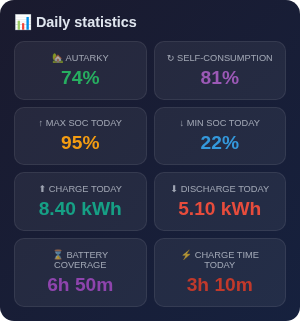

# ioBroker.vis-2-widgets-sigenergy

**Tests:** 

## vis-2-widgets-sigenergy Adapter für ioBroker

VIS-2 Widget-Set für den Sigenergy-Energiespeicher-Adapter (`ioBroker.sigenergy`).
Enthält 10 Widgets zur Visualisierung und Steuerung von Energiefluss, Batteriestatus, Echtzeit-Leistung, Tagesstatistiken, AC-Lader, DC-Lader, Wechselrichter, SigenMicro-Mikrowechselrichter-Übersicht, PV-Strings und Fahrzeug-Ladestand.

Seit Version 2.0.0 sind die Widgets ein natives vis-2-React-Widget-Set (React 19, MUI 9).

## Voraussetzungen

- ioBroker mit installiertem und konfiguriertem `sigenergy`-Adapter
- ioBroker VIS-2 Adapter (≥ 2.20.0) — vis-2 2.20 ist die erste Version auf Basis von React 19 und MUI 9
- Die klassische VIS (vis-1) wird nicht unterstützt

## Update von 1.x

- Vorhandene Widgets laufen ohne Neuanlage weiter: Widget-IDs und alle Einstellungen (Objekt-IDs, Titel, Dunkelmodus, Namen) sind dieselben wie bisher.
- vis-2 muss vorher auf 2.20.0 oder neuer aktualisiert werden. Ältere vis-2-Versionen laufen mit React 18 und können dieses Widget-Set nicht laden.
- Alle Texte folgen der Sprache von vis-2 (11 Sprachen). Selbst eingetragene Titel bleiben erhalten; ein leerer Titel zeigt den Standardtitel in der Sprache des Benutzers.
- Die Status-Erklärungen (AC-/DC-Lader) erscheinen als Tooltip, der nicht mehr vom Widget abgeschnitten wird und in jeder Widget-Größe lesbar bleibt.

## Widgets

### Energiefluss-Diagramm
Zeigt den aktuellen Energiefluss zwischen Solar, Batterie, Netz und Haus als animiertes SVG-Diagramm.
Fließende Pfeile visualisieren aktive Verbindungen in Echtzeit.

**OIDs:** `pvPower`, `essPower`, `gridActivePower`, `housePower`, `essSoc`

#### Flussrichtungen

| Datenpunkt | Wert > 0 | Wert < 0 |
|---|---|---|
| `essPower` | Batterie wird geladen → Pfeil von Mitte zur Batterie | Batterie entlädt → Pfeil von Batterie zur Mitte |
| `gridActivePower` | Netzbezug → Pfeil vom Netz zur Mitte | Einspeisung → Pfeil von Mitte zum Netz |
| `pvPower` | PV erzeugt → Pfeil von PV zur Mitte | — |
| `housePower` | Haus verbraucht → Pfeil von Mitte zum Haus | — |

### Akku-Status & Prognosen
Zeigt SOC, SOH, Ladeleistung sowie Prognosen für Ladezeit, Restlaufzeit, Eigenverbrauch und Autarkierate.

**OIDs:** `essSoc`, `essSoh`, `essPower`, `batteryTimeToFull`, `batteryTimeRemaining`, `selfConsumptionRate`, `autarkyRate`

### Echtzeit-Leistung
Kompakte Listenansicht aller aktuellen Leistungswerte mit farbkodierter Richtungsanzeige.

**OIDs:** `pvPower`, `essPower`, `gridActivePower`, `housePower`, `essSoc`

### Energiestatistiken
Tagesübersicht mit Autarkierate, Eigenverbrauch, SOC-Verlauf, Lade-/Entladeenergie und Batteriedeckung.

**OIDs:** `autarkyRate`, `selfConsumptionRate`, `dayMaxSoc`, `dayMinSoc`, `essDailyChargeEnergy`, `essDailyDischargeEnergy`, `batteryCoverageToday`, `batteryDailyChargeTime`

### AC-Lader (Sigen EVAC)
Überwachung und Steuerung des Sigenergy AC-Laders (EVAC). Zeigt Ladeleistung, Systemzustand, Nennleistung, Nennstrom und Gesamtenergieverbrauch. Alarme werden farblich hervorgehoben. Das Status-Badge zeigt den vereinfachten Ladezustand nach IEC 61851-1 (Initialisierung, Frei, Verbunden, Lädt, Fehler); beim Überfahren mit der Maus erscheint eine ausführliche Erklärung des aktuellen Zustands. Der Ladestrom lässt sich per Schieberegler (6 A bis zum Nennstrom des Laders) direkt einstellen; die Obergrenze kann über die Widget-Einstellung `sig_maxCurrent` zusätzlich begrenzt werden. Während eines aktiven Ladevorgangs ist der Start-Button gesperrt und der Stop-Button hervorgehoben.

**OIDs:** `acCharger.systemState`, `acCharger.chargingPower`, `acCharger.totalEnergyConsumed`, `acCharger.ratedPower`, `acCharger.ratedCurrent`, `acCharger.alarm1/2/3`, `acCharger.control.startStop`, `acCharger.control.outputCurrent`

### DC-Lader
Überwachung und Steuerung des Sigenergy DC-Laders. Zeigt Ausgangsleistung, Fahrzeug-SOC mit Fortschrittsbalken, Fahrzeugspannung, Ladestrom sowie Energie und Dauer der aktuellen Ladesitzung. Das Status-Badge zeigt den Betriebszustand der Ladesäule (`dcCharger.runningState`: Frei, Verbunden/Vorbereitung, Geplant, Lädt, Entlädt, Beendet, Warnung, Fehler/Nicht verfügbar); beim Überfahren mit der Maus erscheint eine ausführliche Erklärung. Während des Ladens oder Entladens ist der Start-Button gesperrt und der Stop-Button hervorgehoben. Ist keine State-OID gesetzt, wird sie aus der Leistungs-OID abgeleitet; liegt kein Zustandswert vor, greift der Badge auf die Ausgangsleistung zurück und der Tooltip erklärt den Grund abhängig von der vom Adapter erkannten Protokollversion.

**OIDs:** `dcCharger.runningState`, `dcCharger.outputPower`, `dcCharger.vehicleSoc`, `dcCharger.vehicleBatteryVoltage`, `dcCharger.chargingCurrent`, `dcCharger.currentChargingCapacity`, `dcCharger.currentChargingDuration`, `dcCharger.control.startStop`, `info.protocolVersion` (`oid_protocol`)

### Inverter
Umfassende Überwachung und Steuerung des Wechselrichters mit Tab-Navigation. Zeigt Betriebszustand, Leistungsdaten, Batterietemperaturen, Phasenspannungen, alle 5 Alarm-Register sowie Geräteinformationen (Modell, Seriennummer, Firmware).

| Tab | Inhalt |
|---|---|
| **Leistung** | Wirkleistung, PV-Leistung, Batterie-Lade/-Entladeleistung, Leistungsanteil-Slider (−100 % bis +100 %) |
| **Batterie** | SOC & SOH mit Balken, Ø Zelltemperatur, Ø Zellspannung, Max/Min Temperatur |
| **Netz** | Phasenspannungen L1/L2/L3, Netzfrequenz, Leistungsfaktor, PCS-Innentemperatur |
| **Alarme** | 5 Alarm-Register (PCS ×2, ESS, Gateway, DC-Lader) mit Hex-Code und Farbmarkierung |
| **Info** | Modelltyp, Seriennummer, Firmware-Version, Remote-EMS-Toggle |

**OIDs:** `inverter.activePower`, `inverter.pvPower`, `inverter.essChargeDischargePower`, `inverter.runningState`, `inverter.essBatterySoc/Soh`, `inverter.essAvgCellTemperature/Voltage`, `inverter.phaseA/B/CVoltage`, `inverter.gridFrequency`, `inverter.pcsInternalTemp`, `inverter.alarm1–5`, `inverter.firmwareVersion`, `inverter.modelType`, `inverter.serialNumber`, `inverter.control.startStop`, `inverter.control.remoteEmsDispatchEnable`, `inverter.control.activePowerPercent`

### PV Power
Darstellung von bis zu 3 PV-Strings mit Live-Leistungswerten und animierten Fluss-Pfeilen zum Hybrid-Wechselrichter. Pfeilfarben ändern sich dynamisch je nach Leistung (orange <1 kW, gelb <2 kW, grün >2 kW).

#### Widget-Einstellungen
| Parameter | Typ | Standard | Beschreibung |
|---|---|---|---|
| oid_pv1 … oid_pv3 | OID | sigenergy.0.plant.pv1Power … pv3Power | PV-String-Leistungs-OIDs |
| oid_pvtotal | OID | sigenergy.0.plant.pvPower | Gesamt-PV-Leistung OID |
| sig_title | Text | PV Power | Widget-Titel |
| sig_name1 … sig_name3 | Text | String 1 … String 3 | Frei wählbare Namen je String |
| sig_darkmode | Checkbox | true | Dunkel- / Hellmodus |

**OIDs:** `plant.pv1Power`, `plant.pv2Power`, `plant.pv3Power`, `plant.pvPower`

### SigenMicro Übersicht
Übersicht und Detailansicht der SigenMicro-Mikrowechselrichter. Seit `ioBroker.sigenergy` 3.5.0 liest der Adapter sie über die Sigenergy-Cloud (Reiter „SigenMicro (Cloud)“ in den Adapter-Einstellungen) und legt je Mikrowechselrichter ein Gerät unter `sigenergy.0.sigenmicro.<Seriennummer>` an. **Voraussetzung: `ioBroker.sigenergy` ≥ 3.5.0 mit aktivierter Cloud.** Die Cloud wird alle 300 s (OpenAPI) bzw. 60 s (App-Schnittstelle) abgefragt, schneller kann das Widget nicht aktualisieren.

| Tab | Inhalt |
|---|---|
| **Overview** | Alle Geräte als animierter AC-Bus mit Status je Gerät; Kacheln für AC-Leistung (Adapter-Summe `sigenmicro.totalPower`, sonst Summe der Geräte), Tagesertrag, Gesamtertrag und Geräte online |
| **ein Tab je Gerät** | Bild, Name, Nennleistung, Seriennummer, Firmware, Zeit der letzten Cloud-Aktualisierung, Status-Badge, alle Live-Werte mit Einheit und OID sowie die vom Adapter gemeldeten PV-Eingänge pv1 … pv4 |

#### Status
| Status | Bedingung | Anzeige |
|---|---|---|
| Producing | `online` = true, `activePower` > 0 | grün, Bus animiert |
| Online | `online` = true, `activePower` = 0 | blau |
| Offline | `online` = false — nachts normal | grau |
| No data | noch kein Wert empfangen | grau |

Ist `info.cloudConnection` `false`, zeigt das Widget den Hinweis „Cloud connection lost“, da die Werte veraltet sein können.

#### Dynamisches Layout
| Geräte | Zeilen | Bildgröße |
|---|---|---|
| 1–5 | 1 Zeile | 80 × 90 px |
| 6–10 | 1 Zeile | 52 × 60 px |
| 11–15 | 2 Zeilen | 46 × 52 px |
| 16–20 | 2 Zeilen | 40 × 46 px |

#### Widget-Einstellungen
| Parameter | Typ | Standard | Beschreibung |
|---|---|---|---|
| micro_count | Zahl (1–20) | 3 | Anzahl der anzuzeigenden Mikrowechselrichter |
| sig_title | Text | SigenMicro Micro-Inverter | Widget-Titel |
| sig_darkmode | checkbox | true | Dunkel- / Hellmodus |
| micro_device1 … micro_device20 | Auswahl | — | Mikrowechselrichter aus der Liste der SigenMicro-Geräte der sigenergy-Instanzen (Seriennummer und Name). Das Widget liest alle States des Geräts selbst. Widgets aus 1.x behalten ihre bisherige State-Auswahl |
| micro_take_all | Schaltfläche | — | Übernimmt alle SigenMicro-Geräte des Kontos auf einmal (Anzahl und Auswahl) |
| micro_name1 … micro_name20 | Text | — | Anzeigename des Geräts (Standard: Micro 01, Micro 02, …) |

**States je Gerät (`sigenergy.0.sigenmicro.<serial>`):**
online, activePower, reactivePower, pvPower, pv1…pv4.voltage / current / power, gridVoltage, gridCurrent, gridFrequency, powerFactor, temperature, insulationResistance, dailyYield, totalYield, serialNumber, firmware, ratedPower, lastUpdate

**Zusätzlich:** `sigenergy.0.sigenmicro.totalPower`, `sigenergy.0.info.cloudConnection` — die Instanz wird aus der gewählten OID übernommen

> **Update von 1.8.x:** Die bisherigen Modbus-States (`runningState`, `outputPower`, `mppt*`, `modelType` …) gibt es im Adapter nicht mehr. Die Mikrowechselrichter in den Widget-Einstellungen neu auswählen — aus der Liste oder mit „Alle SigenMicro übernehmen“.

### Fahrzeug-Ladestand (EV SOC)
Zeigt ein konfigurierbares Fahrzeugbild (z.B. Fiat 500e) als zentrales Sichtelement. Ein farbkodierter Badge in der oberen rechten Ecke zeigt ein Blitz-Symbol, den aktuellen Ladestand in Prozent und die Beschriftung „LADESTAND“ (übersetzt). Ein Ladebalken am unteren Rand spiegelt den aktuellen SOC wider. Wenn der optionale Lade-Status aktiv ist, pulsiert der Badge mit einem grünen Leuchten.

#### Farb-Logik
| Ladestand | Farbe |
|---|---|
| ≤ 15 % | Rot (#f87171) |
| ≤ 35 % | Gelb (#fbbf24) |
| > 35 % | Grün (#4ade80) |

#### Widget-Einstellungen
| Parameter | Typ | Standard | Beschreibung |
|---|---|---|---|
| oid_ev_soc | OID | — | Ladestand 0–100 |
| oid_charging | OID | — | Lade-Status (optional) — grüner Glow bei aktivem Laden |
| sig_title | Text | — (leer: „Fahrzeug-Ladestand“, übersetzt) | Fahrzeugname unter dem Bild |
| sig_car_image | Bild | — | Fahrzeugbild aus dem ioBroker-Datei-Browser (z.B. /vis-2/img/) |
| sig_darkmode | Checkbox | true | Dunkel- / Hellmodus |

**OIDs:** `oid_ev_soc`, `oid_charging`

## Darstellung

Alle Widgets unterstützen einen **Hell- und Dunkelmodus**, der über die Widget-Einstellung `Dunkelmodus` umgeschaltet werden kann. Die Widgets skalieren mit ihrer Größe: Breite und Höhe folgen dem Widget unabhängig voneinander, die Schrift behält ihre Proportionen.

## Changelog
### 2.0.0 (2026-11-17)
* (ssbingo) **Breaking:** Die Widgets sind jetzt ein natives vis-2-React-Widget-Set (React 19, MUI 9) und benötigen vis-2 2.20.0 oder neuer. Die klassische VIS (vis-1) wird nicht mehr unterstützt
* (ssbingo) Vorhandene Widgets laufen ohne Neuanlage weiter: Widget-IDs und alle Einstellungen sind unverändert
* (ssbingo) Alle Texte sind in die 11 ioBroker-Sprachen übersetzt (bisher überwiegend Deutsch). Selbst eingetragene Titel bleiben erhalten; ein leerer Titel zeigt den Standardtitel in der Sprache des Benutzers
* (ssbingo) AC-/DC-Lader: Die Status-Erklärung ist ein MUI-Tooltip, der nicht mehr vom Widget abgeschnitten wird; Ladestrom und EMS-Leistungsanteil sind MUI-Schieberegler, die beim Loslassen schreiben
* (ssbingo) Aus dem vis-2-Editor werden keine Befehle mehr gesendet; ein Klick dort wählt nur das Widget aus
* (ssbingo) Energiefluss: Die Einstellung „Animierter Fluss“ wirkt jetzt
* (ssbingo) SigenMicro: Der Detail-Tab zeigt die Werte in drei Spalten, die Objekt-ID einzeilig
* (ssbingo) SigenMicro: Die Mikrowechselrichter werden im Editor per Gerät (Seriennummer und Name) aus den SigenMicro-Geräten der sigenergy-Instanzen ausgewählt; das Widget liest alle States selbst. Neue Schaltfläche „Alle SigenMicro übernehmen“ übernimmt alle Geräte auf einmal. Widgets aus 1.x laufen mit ihrer bisherigen State-Auswahl weiter
* (ssbingo) Build mit Vite und Module Federation; die Widgets wurden in vis-2 2.20.11 getestet

### 1.9.1 (2026-11-17)
* (ssbingo) vis-2 2.20.x: Die Widgets setzen `box-sizing: border-box` für ihren eigenen Inhalt wieder selbst. vis-2 2.20 lädt MUIs `CssBaseline` nicht mehr, das bisher das ganze Dokument auf border-box umgestellt hat; Karten, Kacheln und Buttons mit Innenabstand konnten dadurch breiter als vorgesehen werden. Die Regel gilt nur für dieses Widget-Set; das Set enthält keinen React-/MUI-Code und läuft als klassisches vis-Widget-Set unter vis-2 2.20 (React 19, MUI 9)

### 1.9.0 (2026-11-17)
* (ssbingo) **SigenMicro-Übersicht für die neue Cloud-Anbindung von `ioBroker.sigenergy` 3.5.0 überarbeitet.** Das Widget liest jetzt `sigenergy.0.sigenmicro.<Seriennummer>.*` (online, activePower, pvPower, PV-Eingänge pv1…pv4, Netzwerte, Temperatur, Isolationswiderstand, Ertrag, Firmware, Nennleistung, letzte Aktualisierung), die Kontosumme `sigenmicro.totalPower` und `info.cloudConnection`. Das bisherige Modbus-Registermodell (`runningState`, `outputPower`, `mppt*`, `modelType`) entfällt
* (ssbingo) SigenMicro: Status aus `online` und AC-Leistung (Producing / Online / Offline / No data), Hinweis bei verlorener Cloud-Verbindung, Zeit der letzten Cloud-Aktualisierung und Nennleistung im Detail-Tab, PV-Eingänge nur wenn gemeldet, neuer optionaler Anzeigename je Gerät (`micro_nameN`), alle Widget-Texte auf Englisch
* (ssbingo) SigenMicro: Die Anker-OID darf ein beliebiger State des Mikrowechselrichters sein; abgeleitete States werden jetzt per `vis.conn.subscribe` abonniert (VIS abonniert nur Attribut-OIDs) und beim Entfernen des Widgets wieder freigegeben. **Nach dem Update für jede `oid_microN` einen State unter `sigenergy.0.sigenmicro.<Seriennummer>` neu auswählen**
* (ssbingo) CI: Dependabot-Auto-Merge-Workflow aus der ioBroker-Vorlage aktualisiert — er nutzt `pull_request` statt `pull_request_target` (#46, #47); `@iobroker/testing` von 6.2.1 auf 6.3.1 aktualisiert

### 1.8.11 (2026-09-12)
* (ssbingo) CI: Die Paket-Tests laufen jetzt unter Node.js 22, 24 und 26 (neuer Job `adapter-tests`, Repository-Checker #41); `@iobroker/testing` von 5.3.0 auf 6.2.1 aktualisiert

### 1.8.10 (2026-09-07)
* (ssbingo) Eintrag `admin` aus `globalDependencies` entfernt: Ein Widget-Set hat keine Admin-Oberfläche, daher muss keine admin-Version vorausgesetzt werden (Repository-Checker S1091)

### 1.8.9 (2026-09-07)
* (ssbingo) DC-Charger: Meldet die Säule ihr Betriebszustands-Register als ungültig, erscheint kein rotes „Unbekannt“-Badge mehr. Das Sigenergy-Protokoll kennzeichnet „Register ungültig“ durch Setzen aller Bits, und ein SigenStor EC **mit** DC-Charger antwortet so für Register 31513, während die Nachbarregister (Nennleistung, PV-Ertrag, Zähler) normal lesen. Der Badge wird dann aus der Ausgangsleistung abgeleitet und der Tooltip stellt klar, dass weder ein Adapter- noch ein Konfigurationsproblem vorliegt
* (ssbingo) DC-Charger: Auch der rohe Kennwert 65535 wird erkannt, damit der Badge auch mit Adapter-Versionen vor 3.3.1 stimmt, die den Wert durchreichen statt keinen Wert zu melden
* (ssbingo) DC-Charger: Neue OID-Einstellung `oid_protocol` (Vorbelegung `sigenergy.0.info.protocolVersion`). Die Protokollversion wurde bisher nur aus dem Instanz-Präfix abgeleitet; eine solche OID abonniert VIS nicht, `vis.states` blieb leer und der Tooltip behauptete „Protokollversion noch nicht erkannt“, obwohl der Adapter beim Start V2.9 erkannt hatte. Als reguläres `/id`-Attribut wird sie wie jede andere OID abonniert
* (ssbingo) DC-Charger: Ist die Protokollversion nicht ablesbar, behauptet der Tooltip nicht mehr, es sei keine erkannt worden, sondern sagt, dass sie hier nicht ablesbar ist, und verweist auf die neue Einstellung
* (ssbingo) DC-Charger: Tooltip für den Fall umformuliert, dass der Adapter keinen Zustand liefert, obwohl das Gerät Protokoll V2.8 oder neuer meldet; er behauptet nicht mehr, ein Adapter-Update sei nötig, da die Säule selbst das Register als ungültig kennzeichnen kann

### 1.8.8 (2026-09-07)
* (ssbingo) DC-Charger: Ist keine State-OID gesetzt, wird sie aus der Leistungs-OID abgeleitet (…dcCharger.outputPower → …dcCharger.runningState); vor 1.8.7 platzierte Widgets zeigen den Betriebszustand damit ohne Nacharbeit
* (ssbingo) DC-Charger: Liegt kein Betriebszustand vor, erklärt der Tooltip den Grund abhängig von der vom Adapter erkannten Protokollversion (`info.protocolVersion` / `info.protocolLevel`): Register 31513 erfordert Sigenergy-Protokoll V2.8, ab V2.8 wird auf Adapter-Log bzw. Adapter-Update verwiesen; negative Ausgangsleistung wird als Entladen angezeigt

### 1.8.7 (2026-09-07)
* (ssbingo) DC-Charger: Neue State-OID `dcCharger.runningState` (Vorbelegung) – der Status-Badge zeigt jetzt den Betriebszustand der Ladesäule (Frei, Verbunden/Vorbereitung, Geplant, Lädt, Entlädt, Beendet, Warnung, Fehler/Nicht verfügbar) mit ausführlicher Erklärung als Tooltip; ohne OID wird der Badge wie bisher aus der Ausgangsleistung abgeleitet
* (ssbingo) DC-Charger: Während des Ladens oder Entladens ist der Start-Button gesperrt und der Stop-Button hervorgehoben; negative Ausgangsleistung (Entladen) wird violett dargestellt

### 1.8.6 (2026-09-07)
* (ssbingo) AC-Charger: Der Tooltip am Status-Badge wird jetzt als eigenes Popup mit fester Schriftgröße und deckendem Hintergrund dargestellt und ist damit unabhängig von der Widget-Größe lesbar und wird nicht mehr von Widget-Inhalten überlagert
* (ssbingo) AC-Charger: Während eines aktiven Ladevorgangs ist der Start-Button gesperrt und der Stop-Button hervorgehoben
* (ssbingo) Das Widget-Set meldet in der Browser-Konsole jetzt die korrekte Version

### 1.8.5 (2026-09-07)
* (ssbingo) AC-Charger: Der Ladestrom-Slider ist jetzt auf den Nennstrom des Laders begrenzt; neue Widget-Einstellung `sig_maxCurrent` für eine manuelle Obergrenze (verhindert Modbus-Fehler bei Werten über dem Nennstrom)
* (ssbingo) AC-Charger: Der Systemzustand deckt jetzt alle IEC-61851-1-Zustände ab (0–7: Initialisierung, Frei, Verbunden, Lädt, Fehler); beim Überfahren des Status-Badges erscheint eine ausführliche Erklärung

### 1.8.4 (2026-09-04)
* (ssbingo) Admin-Mindestanforderung auf >=7.8.23 gesenkt (admin 8 ist nicht mehr erforderlich)
* (ssbingo) CI: ioBroker/testing-action-deploy auf Hauptversion v1 gelockt; Dependabot-Auto-Merge-Workflow repariert
* (ssbingo) Abhängigkeiten aktualisiert: @tsconfig/node22 22.0.6, @alcalzone/release-script-plugin-license 5.2.2

### 1.8.3 (2026-08-05)
* (ssbingo) Mindestanforderungen deklariert: js-controller >=6.0.11, admin >=8.0.0, Node.js >=22
* (ssbingo) Abhängigkeiten aktualisiert: actions/checkout 7.0.1, ioBroker/testing-action-deploy 1.5.2, @iobroker/testing 5.3.0

### 1.8.2 (2026-06-28)
* (ssbingo) CI-Actions aktualisiert: actions/checkout auf v7.0.0, ioBroker/testing-action-deploy auf v1.5.0

### 1.8.1 (2026-06-08)
* (ssbingo) JSON-Syntaxfehler in io-package.json behoben; Widget-Screenshot zur Dokumentation hinzugefügt

### 1.8.0 (2026-06-08)
* (ssbingo) Neues Widget: „Fahrzeug-Ladestand" — zeigt ein konfigurierbares Fahrzeugbild mit animiertem SOC-Balken, farbkodiertem Ladestand (rot/gelb/grün) und optionalem blinkendem Lade-Badge

### 1.7.9 (2026-05-27)
* (ssbingo) Veraltete .eslintrc.json und .prettierignore entfernt

### 1.7.8 (2026-05-27)
* (ssbingo) ESLint-Linting hinzugefügt, CI auf Node.js 24 aktualisiert; Adapter erfordert node.js >= 22

### 1.7.7 (2026-04-20)
* (ssbingo) Schrift wird bei non-uniform Skalierung nicht mehr verzerrt — Buchstaben behalten ihre Proportionen, während Container die Widget-Fläche weiterhin füllen

### 1.7.6 (2026-04-20)
* (ssbingo) Skalierung erfolgt jetzt non-uniform: Breite und Höhe reagieren unabhängig auf Container-Änderungen, beide Achsen bleiben einzeln anpassbar

### 1.7.5 (2026-04-20)
* (ssbingo) Widget-Skalierung reagiert jetzt auch auf Höhenänderungen — Inhalt skaliert proportional auf beiden Achsen und wird im Widget zentriert

### 1.7.4 (2026-04-20)
* (ssbingo) Alle 9 Widgets skalieren ihre Inhalte jetzt responsiv mit der Widget-Größe (Schrift, Abstände, SVG, Bilder)

### 1.7.3 (2026-04-20)
* (ssbingo) Alle 9 Widgets haben jetzt einen einheitlichen Hintergrund basierend auf dem PV-Power-Widget-Design

## Lizenz
MIT License

Copyright (c) 2026 ssbingo <s.sternitzke@online.de>

Hiermit wird unentgeltlich jeder Person, die eine Kopie der Software und der zugehörigen
Dokumentationen (die „Software") erhält, die Erlaubnis erteilt, sie uneingeschränkt zu nutzen,
inklusive und ohne Ausnahme mit dem Recht, sie zu verwenden, zu kopieren, zu verändern,
zusammenzuführen, zu veröffentlichen, zu verbreiten, zu unterlizenzieren und/oder zu verkaufen,
und Personen, denen diese Software überlassen wird, diese Rechte zu verschaffen, unter den
folgenden Bedingungen:

Der obige Urheberrechtsvermerk und dieser Erlaubnisvermerk sind in allen Kopien oder
wesentlichen Teilen der Software beizulegen.

DIE SOFTWARE WIRD OHNE JEDE AUSDRÜCKLICHE ODER IMPLIZIERTE GARANTIE BEREITGESTELLT,
EINSCHLIEẞLICH DER GARANTIE ZUR BENUTZBARKEIT, EIGNUNG FÜR EINEN BESTIMMTEN ZWECK UND
NICHTVERLETZUNG. IN KEINEM FALL SIND DIE AUTOREN ODER COPYRIGHTINHABER FÜR EINEN SCHADEN
ODER SONSTIGE ANSPRÜCHE HAFTBAR ZU MACHEN, OB INFOLGE DER ERFÜLLUNG EINES VERTRAGES,
EINES DELIKTES ODER ANDERS IM ZUSAMMENHANG MIT DER SOFTWARE ODER SONSTIGER VERWENDUNG
DER SOFTWARE ENTSTANDEN.

## Dokumentation

- 🇩🇪 [Deutsch](../../doc/de/README.md) — diese Datei
- 🇬🇧 [English](../../README.md)
- 🇷🇺 [Русский](../../doc/ru/README.md)
- 🇳🇱 [Nederlands](../../doc/nl/README.md)
- 🇫🇷 [Français](../../doc/fr/README.md)
- 🇮🇹 [Italiano](../../doc/it/README.md)
- 🇪🇸 [Español](../../doc/es/README.md)
- 🇵🇱 [Polski](../../doc/pl/README.md)
- 🇵🇹 [Português](../../doc/pt/README.md)
