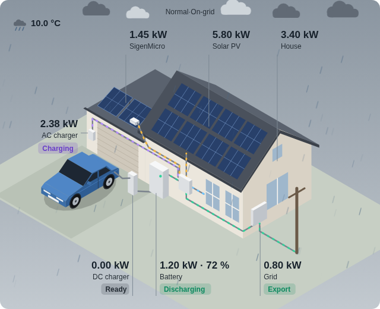
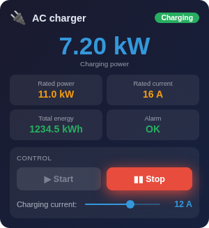
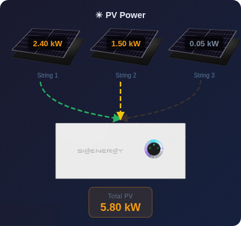
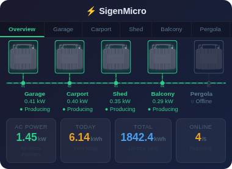

# ioBroker.vis-2-widgets-sigenergy

**Tests :** 

## Adaptateur vis-2-widgets-sigenergy pour ioBroker

Ensemble de widgets VIS-2 pour l'adaptateur de stockage d'énergie Sigenergy (`ioBroker.sigenergy`).
Contient 11 widgets pour la visualisation et le contrôle du flux d'énergie, de la maison énergie, de l'état de la batterie, de la puissance en temps réel, des statistiques journalières, du chargeur AC, du chargeur DC, de l'onduleur, de la vue d'ensemble des micro-onduleurs SigenMicro, des chaînes photovoltaïques et du niveau de charge du véhicule.

Depuis la version 2.0.0, les widgets forment un ensemble de widgets React natif pour vis-2 (React 19, MUI 9).

## Prérequis

- ioBroker avec l'adaptateur `sigenergy` installé et configuré
- Adaptateur ioBroker VIS-2 (≥ 2.20.0) — vis-2 2.20 est la première version basée sur React 19 et MUI 9
- La VIS classique (vis-1) n'est pas prise en charge

## Mise à jour depuis 1.x

- Les widgets existants continuent de fonctionner sans devoir être replacés : les ID de widget et tous les paramètres (ID d'objet, titres, mode sombre, noms) restent les mêmes qu'auparavant.
- vis-2 doit d'abord être mis à jour en version 2.20.0 ou ultérieure. Les versions antérieures de vis-2 fonctionnent avec React 18 et ne peuvent pas charger cet ensemble de widgets.
- Tous les textes suivent la langue de vis-2 (11 langues). Les titres que vous avez saisis sont conservés ; un titre vide affiche le titre par défaut dans la langue de l'utilisateur.
- Les explications d'état (chargeur AC/DC) s'affichent dans une infobulle qui n'est plus coupée par le widget et reste lisible quelle que soit la taille du widget.

## Widgets

### Diagramme de flux d'énergie
Affiche le flux d'énergie actuel entre les panneaux solaires, la batterie, le réseau et la maison sous forme de diagramme SVG animé. Des flèches animées visualisent les connexions actives en temps réel.

**OID :** `pvPower`, `essPower`, `gridActivePower`, `housePower`, `essSoc`

#### Directions du flux

| Point de données | Valeur > 0 | Valeur < 0 |
|---|---|---|
| `essPower` | Batterie en charge → flèche du centre vers la batterie | Batterie en décharge → flèche de la batterie vers le centre |
| `gridActivePower` | Soutirage réseau → flèche du réseau vers le centre | Injection réseau → flèche du centre vers le réseau |
| `pvPower` | PV produit → flèche du PV vers le centre | — |
| `housePower` | Maison consomme → flèche du centre vers la maison | — |

### Maison énergie
Affiche le flux d'énergie sous la forme d'une maison isométrique avec garage, voiture et les appareils Sigenergy : PV sur le toit, batterie SigenStor et passerelle sur le mur de la maison, borne AC sur le garage, chargeur DC devant, une centrale de balcon avec SigenMicro sur le toit du garage et le raccordement au réseau. Des tirets animés parcourent les câbles dans le sens du flux d'énergie, d'autant plus vite que la puissance est élevée. Le jour et la nuit suivent le soleil au lieu indiqué dans les paramètres système d'ioBroker. Tout est dessiné en graphiques vectoriels : le widget reste net à toute taille et garde ses proportions.

**OIDs :** `pvPower`, `housePower`, `essPower`, `essSoc`, `gridActivePower`, `acCharger.chargingPower`, `acCharger.systemState`, `dcCharger.outputPower`, `dcCharger.runningState`, `sigenmicro.totalPower` ; facultatif : température extérieure (`oid_temp`) et un texte d'état (`oid_status`)

| Paramètre | Défaut | Description |
|---|---|---|
| sig_daynight | Automatique | Automatique (position du soleil), toujours jour ou toujours nuit |
| sig_animation | activé | Flux animé le long des câbles |
| `sig_show_garage`, `sig_show_car`, `sig_show_ac`, `sig_show_dc`, `sig_show_micro` | activé | Afficher ou masquer garage, voiture, borne AC, chargeur DC et centrale de balcon. La centrale de balcon nécessite le garage ; sans garage, la borne AC est fixée au mur de la maison |

**Météo (facultatif) :** avec un état météo, le ciel suit la météo réelle — soleil, nuages, pluie, neige, brouillard ou orage ; sans état, il reste dégagé. Le code indépendant de la langue de l'adaptateur météo est utilisé ; les textes météo en anglais sont également reconnus.

| Adaptateur | Conditions météo | Couverture nuageuse (%) | Précipitations (mm/h) | Code météo numérique |
|---|---|---|---|---|
| open-meteo-weather | `…weather.current.weather_code` | `…weather.current.cloud_cover` | `…weather.current.precipitation` | Automatique |
| openweathermap | `forecast.current.icon` | `forecast.current.clouds` | `forecast.current.precipitation` | Automatique |
| daswetter | `location_1.ForecastHourly.Current.symbol` | `…Current.clouds` | `…Current.rain` | Symbole DasWetter |

daswetter n'écrit le canal `Current` qu'avec l'option de copie de l'heure actuelle ; sinon utilisez `ForecastHourly.Hour_1`. `symbol_URL` fonctionne aussi, avec le code sur Automatique.

La couverture nuageuse et les précipitations précisent les conditions ou les remplacent ; les précipitations à 1 °C ou moins sont dessinées en neige.

### État de la batterie & prévisions
Affiche SOC, SOH, puissance de charge et prévisions pour le temps de charge, l'autonomie restante, l'autoconsommation et le taux d'autarcie.

**OID :** `essSoc`, `essSoh`, `essPower`, `batteryTimeToFull`, `batteryTimeRemaining`, `selfConsumptionRate`, `autarkyRate`

### Puissance en temps réel
Vue liste compacte de toutes les valeurs de puissance actuelles avec indicateur de direction par code couleur.

**OID :** `pvPower`, `essPower`, `gridActivePower`, `housePower`, `essSoc`

### Statistiques énergétiques
Récapitulatif journalier avec taux d'autarcie, autoconsommation, évolution du SOC, énergie de charge/décharge et couverture batterie.

**OID :** `autarkyRate`, `selfConsumptionRate`, `dayMaxSoc`, `dayMinSoc`, `essDailyChargeEnergy`, `essDailyDischargeEnergy`, `batteryCoverageToday`, `batteryDailyChargeTime`

### Chargeur AC (Sigen EVAC)
Surveillance et contrôle du chargeur AC Sigenergy (EVAC). Affiche la puissance de charge, l'état du système, la puissance nominale, le courant nominal et la consommation totale d'énergie. Les alarmes sont mises en évidence par couleur. Le badge d'état affiche l'état de charge simplifié selon IEC 61851-1 (Initialisation, Libre, Connecté, En charge, Erreur) ; au survol de la souris, une explication détaillée de l'état actuel s'affiche. Le courant de charge est réglable via un curseur (de 6 A jusqu'au courant nominal du chargeur) ; la limite supérieure peut en plus être plafonnée via le réglage du widget `sig_maxCurrent`. Pendant une charge active, le bouton Start est verrouillé et le bouton Stop est mis en évidence.

**OID :** `acCharger.systemState`, `acCharger.chargingPower`, `acCharger.totalEnergyConsumed`, `acCharger.ratedPower`, `acCharger.ratedCurrent`, `acCharger.alarm1/2/3`, `acCharger.control.startStop`, `acCharger.control.outputCurrent`

### Chargeur DC
Surveillance et contrôle du chargeur DC Sigenergy. Affiche la puissance de sortie, le SOC du véhicule avec barre de progression, la tension de la batterie du véhicule, le courant de charge ainsi que l'énergie et la durée de la session de charge en cours. Le badge d'état affiche l'état de fonctionnement de la borne (`dcCharger.runningState` : libre, connecté/préparation, planifié, en charge, en décharge, terminé, avertissement, défaut/indisponible) ; au survol de la souris, une explication détaillée s'affiche. Pendant une charge ou une décharge active, le bouton Start est verrouillé et le bouton Stop est mis en évidence. Si l'OID d'état n'est pas défini, il est dérivé de l'OID de puissance de sortie ; sans valeur d'état, le badge se rabat sur la puissance de sortie et l'infobulle en explique la raison selon la version de protocole détectée par l'adaptateur.

**OID :** `dcCharger.runningState`, `dcCharger.outputPower`, `dcCharger.vehicleSoc`, `dcCharger.vehicleBatteryVoltage`, `dcCharger.chargingCurrent`, `dcCharger.currentChargingCapacity`, `dcCharger.currentChargingDuration`, `dcCharger.control.startStop`, `info.protocolVersion` (`oid_protocol`)

### Onduleur
Surveillance et contrôle complets de l'onduleur avec navigation par onglets. Affiche l'état de fonctionnement, les données de puissance, les températures de la batterie, les tensions de phase, les 5 registres d'alarmes et les informations de l'appareil (modèle, numéro de série, firmware).

| Onglet | Contenu |
|---|---|
| **Puissance** | Puissance active, puissance PV, puissance de charge/décharge batterie, curseur de part de puissance (de −100 % à +100 %) |
| **Batterie** | SOC et SOH avec barres, température/tension moyenne des cellules, température max./min. |
| **Réseau** | Tensions de phase L1/L2/L3, fréquence réseau, facteur de puissance, température interne PCS |
| **Alarmes** | 5 registres d'alarmes (PCS ×2, ESS, passerelle, chargeur DC) avec code hex et marquage couleur |
| **Info** | Type de modèle, numéro de série, version du firmware, commutateur Remote-EMS |

**OID :** `inverter.activePower`, `inverter.pvPower`, `inverter.essChargeDischargePower`, `inverter.runningState`, `inverter.essBatterySoc/Soh`, `inverter.essAvgCellTemperature/Voltage`, `inverter.phaseA/B/CVoltage`, `inverter.gridFrequency`, `inverter.pcsInternalTemp`, `inverter.alarm1–5`, `inverter.firmwareVersion`, `inverter.modelType`, `inverter.serialNumber`, `inverter.control.startStop`, `inverter.control.remoteEmsDispatchEnable`, `inverter.control.activePowerPercent`

### PV Power
Affichage jusqu'à 3 chaînes PV avec valeurs de puissance en direct et flèches de flux animées vers l'onduleur hybride. Les couleurs des flèches changent dynamiquement selon la puissance (orange <1 kW, jaune <2 kW, vert >2 kW).

#### Paramètres du widget
| Paramètre | Type | Défaut | Description |
|---|---|---|---|
| oid_pv1 … oid_pv3 | OID | sigenergy.0.plant.pv1Power … pv3Power | OID de puissance par chaîne PV |
| oid_pvtotal | OID | sigenergy.0.plant.pvPower | OID de puissance PV totale |
| sig_title | texte | PV Power | Titre du widget |
| sig_name1 … sig_name3 | texte | String 1 … String 3 | Noms configurables par chaîne |
| sig_darkmode | case à cocher | true | Mode sombre / clair |

**OIDs:** `plant.pv1Power`, `plant.pv2Power`, `plant.pv3Power`, `plant.pvPower`

### Vue d'ensemble SigenMicro
Vue d'ensemble et vue détaillée des micro-onduleurs SigenMicro. Depuis `ioBroker.sigenergy` 3.5.0, l'adaptateur les lit via le cloud Sigenergy (onglet « SigenMicro (Cloud) » dans les paramètres de l'adaptateur) et crée un appareil par micro-onduleur sous `sigenergy.0.sigenmicro.<numéro de série>`. **Nécessite `ioBroker.sigenergy` ≥ 3.5.0 avec le cloud activé.** Le cloud est interrogé toutes les 300 s (OpenAPI) ou 60 s (interface de l'application) ; le widget ne peut donc pas se mettre à jour plus vite.

| Onglet | Contenu |
|---|---|
| **Overview** | Tous les appareils sous forme de bus AC animé avec l'état de chacun ; tuiles pour la puissance AC (total de l'adaptateur `sigenmicro.totalPower`, sinon somme des appareils), la production du jour, la production totale et les appareils en ligne |
| **un onglet par appareil** | Image, nom, puissance nominale, numéro de série, firmware, heure de la dernière mise à jour du cloud, badge d'état, toutes les valeurs instantanées avec unité et OID, ainsi que les entrées PV pv1 … pv4 signalées par l'adaptateur |

#### État
| État | Condition | Affichage |
|---|---|---|
| Producing | `online` = true, `activePower` > 0 | vert, bus animé |
| Online | `online` = true, `activePower` = 0 | bleu |
| Offline | `online` = false — normal la nuit | gris |
| No data | aucune valeur reçue pour l'instant | gris |

Si `info.cloudConnection` vaut `false`, le widget affiche l'avertissement « Cloud connection lost », car les valeurs peuvent être obsolètes.

#### Mise en page dynamique
| Appareils | Rangées | Taille de l'image |
|---|---|---|
| 1–5 | 1 rangée | 80 × 90 px |
| 6–10 | 1 rangée | 52 × 60 px |
| 11–15 | 2 rangées | 46 × 52 px |
| 16–20 | 2 rangées | 40 × 46 px |

#### Paramètres du widget
| Paramètre | Type | Défaut | Description |
|---|---|---|---|
| micro_count | nombre (1–20) | 3 | Nombre de micro-onduleurs à afficher |
| sig_title | texte | SigenMicro Micro-Inverter | Titre du widget |
| sig_darkmode | checkbox | true | Mode sombre / clair |
| micro_device1 … micro_device20 | sélection | — | Micro-onduleur choisi dans la liste des appareils SigenMicro des instances sigenergy (numéro de série et nom). Le widget lit lui-même tous les états de l'appareil. Les widgets de la 1.x conservent leur ancienne sélection d'état |
| micro_take_all | bouton | — | Reprend en une fois tous les appareils SigenMicro du compte (nombre et sélection) |
| micro_name1 … micro_name20 | texte | — | Nom affiché de l'appareil (par défaut : Micro 01, Micro 02, …) |

**États par appareil (`sigenergy.0.sigenmicro.<serial>`):**
online, activePower, reactivePower, pvPower, pv1…pv4.voltage / current / power, gridVoltage, gridCurrent, gridFrequency, powerFactor, temperature, insulationResistance, dailyYield, totalYield, serialNumber, firmware, ratedPower, lastUpdate

**En outre:** `sigenergy.0.sigenmicro.totalPower`, `sigenergy.0.info.cloudConnection` — l'instance est reprise de l'OID sélectionné

> **Mise à jour depuis la 1.8.x:** les anciens états Modbus (`runningState`, `outputPower`, `mppt*`, `modelType` …) n'existent plus dans l'adaptateur. Choisissez à nouveau les micro-onduleurs dans les paramètres du widget — dans la liste ou avec « Reprendre tous les SigenMicro ».

### Niveau de charge du véhicule (EV SOC)
Affiche une image de véhicule configurable (p. ex. Fiat 500e) comme élément visuel central. Un badge coloré en haut à droite montre un symbole d'éclair, le niveau de charge actuel en pourcentage et le libellé « NIVEAU » (traduit). Une barre de progression en bas reflète le SOC actuel. Lorsque l'état de charge optionnel est actif, le badge émet une lueur verte pulsante.

#### Logique de couleur
| Niveau de charge | Couleur |
|---|---|
| ≤ 15 % | Rouge (#f87171) |
| ≤ 35 % | Jaune (#fbbf24) |
| > 35 % | Vert (#4ade80) |

**OIDs:** `oid_ev_soc`, `oid_charging`

## Apparence

Tous les widgets prennent en charge un **mode clair et sombre**, commutable via le paramètre de widget `Mode sombre`. Les widgets s'adaptent à leur taille : la largeur et la hauteur suivent le widget indépendamment l'une de l'autre, tandis que le texte conserve ses proportions.

## Changelog
### 2.2.0 (2026-11-18)
* (ssbingo) **La maison énergie affiche la météo réelle :** avec un état météo (code WMO d'open-meteo-weather, icône ou id OpenWeatherMap, symbole DasWetter, icône AccuWeather ou un texte en anglais), en option couverture nuageuse et précipitations, le ciel affiche soleil, nuages, pluie, neige, brouillard ou orage au lieu de toujours le soleil ; le symbole à côté de la température suit la météo

### 2.1.0 (2026-11-18)
* (ssbingo) **Nouveau widget « Maison énergie » :** le flux d'énergie sous forme de maison isométrique avec garage, voiture, PV sur le toit, SigenStor et passerelle au mur, borne AC, chargeur DC, une centrale de balcon avec SigenMicro sur le toit du garage et le raccordement au réseau ; câbles animés dans le sens du flux, jour et nuit selon la position du soleil, température extérieure et texte d'état facultatifs, chaque élément peut être masqué

### 2.0.2 (2026-11-18)
* (ssbingo) SigenMicro : nouvelle barre d'onglets — « Vue d'ensemble » garde sa largeur, les onglets des appareils se partagent le reste en colonnes égales et ne débordent plus du widget ; jusqu'à 3 appareils les onglets affichent les noms, au-delà des numéros compacts 01, 02 … (comme sur les nœuds, nom en infobulle) ; au-delà de 10 appareils deux lignes comme les nœuds
* (ssbingo) SigenMicro : les libellés se trouvent exactement sous leurs nœuds, chaque ligne de libellés directement sous sa ligne de nœuds ; un clic sur un nœud ou un libellé ouvre l'onglet de détail de l'appareil ; meilleur contraste des textes des tuiles ; si plusieurs appareils sélectionnés signalent le même nom, le numéro de série est affiché
* (ssbingo) Widgets étirés : les textes ne sont plus compressés deux fois, les textes centrés restent centrés, et les titres des chargeurs AC/DC, de l'onduleur et de la batterie ainsi que le badge d'état et l'en-tête de section de SigenMicro gardent leurs proportions

### 2.0.1 (2026-11-17)
* (ssbingo) Captures d'écran du README renouvelées : tous les widgets tels que le jeu de widgets React les affiche dans vis-2 2.20, avec des textes en anglais
* (ssbingo) Dépendances mises à jour (vite 7.3.8, `@iobroker/gui-components` 10.4.6, `@iobroker/testing` 6.3.2)

### 2.0.0 (2026-11-17)
* (ssbingo) **Breaking:** les widgets sont désormais un ensemble de widgets React natif pour vis-2 (React 19, MUI 9) et nécessitent vis-2 2.20.0 ou ultérieur. La VIS classique (vis-1) n'est plus prise en charge
* (ssbingo) Les widgets existants continuent de fonctionner sans devoir être replacés : les ID de widget et tous les paramètres sont inchangés
* (ssbingo) Tous les textes sont traduits dans les 11 langues d'ioBroker (auparavant principalement en allemand). Les titres saisis sont conservés ; un titre vide affiche le titre par défaut dans la langue de l'utilisateur
* (ssbingo) Chargeur AC/DC : l'explication de l'état est une infobulle MUI qui n'est plus coupée par le widget ; le courant de charge et la part de puissance EMS sont des curseurs MUI qui écrivent la valeur au relâchement
* (ssbingo) L'éditeur vis-2 n'envoie plus de commandes ; un clic n'y fait que sélectionner le widget
* (ssbingo) Flux d'énergie : le paramètre « Flux animé » est désormais pris en compte
* (ssbingo) SigenMicro : l'onglet de détail affiche les valeurs sur trois colonnes, l'ID d'objet sur une seule ligne
* (ssbingo) SigenMicro : les micro-onduleurs sont choisis dans l'éditeur par appareil (numéro de série et nom) parmi les appareils SigenMicro des instances sigenergy ; le widget lit lui-même tous les états. Nouveau bouton « Reprendre tous les SigenMicro » qui reprend tous les appareils en une fois. Les widgets de la 1.x continuent de fonctionner avec leur ancienne sélection d'état
* (ssbingo) Compilation avec Vite et la fédération de modules ; les widgets ont été testés dans vis-2 2.20.11

### 1.9.1 (2026-11-17)
* (ssbingo) vis-2 2.20.x : les widgets appliquent à nouveau eux-mêmes `box-sizing: border-box` à leur contenu. vis-2 2.20 ne charge plus le `CssBaseline` de MUI, qui passait jusqu'ici tout le document en border-box ; les cartes, tuiles et boutons avec marge intérieure pouvaient donc devenir plus larges que prévu. La règle ne s'applique qu'à ce jeu de widgets ; le jeu ne contient pas de code React/MUI et fonctionne comme jeu de widgets vis classique sous vis-2 2.20 (React 19, MUI 9)

### 1.9.0 (2026-11-17)
* (ssbingo) **Vue d'ensemble SigenMicro remaniée pour la nouvelle connexion cloud de `ioBroker.sigenergy` 3.5.0.** Le widget lit désormais `sigenergy.0.sigenmicro.<numéro de série>.*` (online, activePower, pvPower, entrées PV pv1…pv4, valeurs réseau, température, résistance d'isolement, production, firmware, puissance nominale, dernière mise à jour), le total du compte `sigenmicro.totalPower` et `info.cloudConnection`. L'ancien modèle de registres Modbus (`runningState`, `outputPower`, `mppt*`, `modelType`) disparaît
* (ssbingo) SigenMicro : état déduit de `online` et de la puissance AC (Producing / Online / Offline / No data), avertissement en cas de perte de la connexion cloud, heure de la dernière mise à jour du cloud et puissance nominale dans l'onglet de détail, entrées PV affichées uniquement si elles sont signalées, nouveau nom d'affichage facultatif par appareil (`micro_nameN`), tous les textes du widget en anglais
* (ssbingo) SigenMicro : l'OID d'ancrage peut être n'importe quel état du micro-onduleur ; les états dérivés sont désormais abonnés via `vis.conn.subscribe` (VIS n'abonne que les OID des attributs) et libérés à la suppression du widget. **Après la mise à jour, sélectionnez à nouveau pour chaque `oid_microN` un état sous `sigenergy.0.sigenmicro.<numéro de série>`**
* (ssbingo) CI : workflow de fusion automatique Dependabot mis à jour depuis le modèle ioBroker — il utilise `pull_request` au lieu de `pull_request_target` (#46, #47) ; `@iobroker/testing` mis à jour de 6.2.1 à 6.3.1

### 1.8.11 (2026-09-12)
* (ssbingo) CI : les tests du paquet s'exécutent désormais sous Node.js 22, 24 et 26 (nouveau job `adapter-tests`, vérificateur de dépôt #41) ; `@iobroker/testing` mis à jour de 5.3.0 à 6.2.1

### 1.8.10 (2026-09-07)
* (ssbingo) Entrée `admin` retirée de `globalDependencies` : un ensemble de widgets n'a pas d'interface d'administration, aucune version d'admin n'a donc à être exigée (vérificateur de dépôt S1091)

### 1.8.9 (2026-09-07)
* (ssbingo) Chargeur DC : une borne qui marque son registre d'état de fonctionnement comme non valide n'apparaît plus avec un badge rouge « Unbekannt ». Le protocole Sigenergy signale « registre non valide » en mettant tous les bits à un, et un SigenStor EC **avec** chargeur DC répond ainsi pour le registre 31513 alors que les registres voisins (puissance nominale, production PV, compteurs) se lisent normalement. Le badge est alors dérivé de la puissance de sortie et l'infobulle précise qu'il ne s'agit ni d'un problème d'adaptateur ni de configuration
* (ssbingo) Chargeur DC : la valeur brute 65535 est également reconnue, de sorte que le badge est aussi correct avec les versions d'adaptateur antérieures à 3.3.1, qui transmettent la valeur au lieu de ne rien signaler
* (ssbingo) Chargeur DC : nouveau réglage d'OID `oid_protocol` (par défaut `sigenergy.0.info.protocolVersion`). La version du protocole n'était auparavant dérivée que du préfixe de l'instance ; VIS ne souscrit pas à un tel OID, `vis.states` restait vide et l'infobulle affirmait « version de protocole pas encore détectée » alors que l'adaptateur avait détecté V2.9 au démarrage. Déclarée comme attribut `/id` ordinaire, elle est souscrite comme tout autre OID
* (ssbingo) Chargeur DC : lorsque la version du protocole ne peut pas être lue, l'infobulle n'affirme plus qu'aucune n'a été détectée ; elle indique qu'elle n'est pas lisible ici et renvoie au nouveau réglage
* (ssbingo) Chargeur DC : reformulation de l'infobulle affichée lorsque l'adaptateur ne signale aucun état bien que l'appareil annonce le protocole V2.8 ou plus récent ; elle n'affirme plus qu'une mise à jour de l'adaptateur est nécessaire, la borne pouvant elle-même marquer le registre comme non valide

### 1.8.8 (2026-09-07)
* (ssbingo) Chargeur DC : si l'OID d'état n'est pas défini, il est dérivé de l'OID de puissance de sortie (…dcCharger.outputPower → …dcCharger.runningState) ; les widgets placés avant 1.8.7 affichent ainsi l'état de fonctionnement sans modification
* (ssbingo) Chargeur DC : en l'absence d'état de fonctionnement, l'infobulle explique la raison selon la version de protocole détectée par l'adaptateur (`info.protocolVersion` / `info.protocolLevel`) : le registre 31513 nécessite le protocole Sigenergy V2.8 ; à partir de V2.8 elle renvoie au journal de l'adaptateur ou à une mise à jour de l'adaptateur ; une puissance de sortie négative est affichée comme décharge

### 1.8.7 (2026-09-07)
* (ssbingo) Chargeur DC : nouvel OID d'état `dcCharger.runningState` (par défaut) – le badge d'état affiche désormais l'état de fonctionnement de la borne (libre, connecté/préparation, planifié, en charge, en décharge, terminé, avertissement, défaut/indisponible) avec une explication détaillée en infobulle ; sans l'OID, le badge est dérivé de la puissance de sortie comme auparavant
* (ssbingo) Chargeur DC : pendant une charge ou une décharge active, le bouton Start est verrouillé et le bouton Stop est mis en évidence ; une puissance de sortie négative (décharge) est affichée en violet

### 1.8.6 (2026-09-07)
* (ssbingo) Chargeur AC : l'infobulle du badge d'état s'affiche désormais dans un popup séparé avec une taille de police fixe et un fond opaque ; elle reste lisible quelle que soit la taille du widget et n'est plus recouverte par le contenu du widget
* (ssbingo) Chargeur AC : pendant une charge active, le bouton Start est verrouillé et le bouton Stop est mis en évidence
* (ssbingo) L'ensemble de widgets indique désormais la version correcte dans la console du navigateur

### 1.8.5 (2026-09-07)
* (ssbingo) Chargeur AC : le curseur de courant de charge est désormais limité au courant nominal du chargeur ; nouveau réglage du widget `sig_maxCurrent` pour une limite supérieure manuelle (évite les erreurs Modbus lors du réglage au-delà du courant nominal)
* (ssbingo) Chargeur AC : l'état du système couvre désormais tous les états IEC 61851-1 (0–7 : initialisation, libre, connecté, en charge, erreur) ; le survol du badge d'état affiche une explication détaillée

### 1.8.4 (2026-09-04)
* (ssbingo) Exigence minimale d'admin abaissée à >=7.8.23 (admin 8 n'est plus requis)
* (ssbingo) CI : ioBroker/testing-action-deploy verrouillé sur la version majeure v1 ; workflow d'auto-merge Dependabot corrigé
* (ssbingo) Dépendances mises à jour : @tsconfig/node22 22.0.6, @alcalzone/release-script-plugin-license 5.2.2

### 1.8.3 (2026-08-05)
* (ssbingo) Exigences minimales déclarées : js-controller >=6.0.11, admin >=8.0.0, Node.js >=22
* (ssbingo) Dépendances mises à jour : actions/checkout 7.0.1, ioBroker/testing-action-deploy 1.5.2, @iobroker/testing 5.3.0

### 1.8.2 (2026-06-28)
* (ssbingo) Actions CI mises à jour : actions/checkout vers v7.0.0, ioBroker/testing-action-deploy vers v1.5.0

### 1.8.1 (2026-06-08)
* (ssbingo) Correction d'une erreur de syntaxe JSON dans io-package.json ; capture d'écran du widget ajoutée à la documentation

### 1.8.0 (2026-06-08)
* (ssbingo) Nouveau widget : « Niveau de charge du véhicule » — affiche une image de VE configurable avec une barre SOC animée, un niveau de charge en couleur (rouge/jaune/vert) et un badge de charge clignotant optionnel

### 1.7.9 (2026-05-27)
* (ssbingo) .eslintrc.json et .prettierignore obsolètes supprimés

### 1.7.8 (2026-05-27)
* (ssbingo) Ajout de l'ESLint, CI mis à jour vers Node.js 24 ; l'adaptateur nécessite node.js >= 22

### 1.7.7 (2026-04-20)
* (ssbingo) Le texte ne se déforme plus en mise à l'échelle non uniforme — les lettres conservent leurs proportions tandis que les conteneurs continuent à remplir la zone du widget

### 1.7.6 (2026-04-20)
* (ssbingo) La mise à l'échelle est désormais non uniforme : largeur et hauteur réagissent indépendamment aux changements du conteneur, les deux axes restent réglables individuellement

### 1.7.5 (2026-04-20)
* (ssbingo) La mise à l'échelle des widgets réagit désormais aussi aux changements de hauteur — le contenu s'adapte proportionnellement sur les deux axes et est centré dans le widget

### 1.7.4 (2026-04-20)
* (ssbingo) Les 9 widgets adaptent désormais leur contenu de manière responsive à la taille du widget (polices, espacements, SVG, images)

### 1.7.3 (2026-04-20)
* (ssbingo) Les 9 widgets partagent désormais un arrière-plan unifié basé sur le design du widget PV-Power

## Licence
MIT License

Copyright (c) 2026 ssbingo <s.sternitzke@online.de>

La présente licence accorde gratuitement à toute personne obtenant une copie de ce logiciel
et des fichiers de documentation associés (le « Logiciel »), la permission de traiter le Logiciel
sans restriction, notamment sans limitation des droits d'utilisation, de copie, de modification,
de fusion, de publication, de distribution, de sous-licence et/ou de vente de copies du Logiciel,
et d'autoriser les personnes à qui le Logiciel est fourni à le faire, sous réserve des conditions
suivantes :

L'avis de droit d'auteur ci-dessus et le présent avis d'autorisation doivent être inclus dans
toutes les copies ou parties substantielles du Logiciel.

LE LOGICIEL EST FOURNI « TEL QUEL », SANS GARANTIE D'AUCUNE SORTE, EXPLICITE OU IMPLICITE,
NOTAMMENT SANS GARANTIE DE QUALITÉ MARCHANDE, D'ADÉQUATION À UN USAGE PARTICULIER ET
D'ABSENCE DE CONTREFAÇON.

## Documentation

- 🇫🇷 [Français](../../doc/fr/README.md) — ce fichier
- 🇩🇪 [Deutsch](../../doc/de/README.md)
- 🇬🇧 [English](../../README.md)
- 🇷🇺 [Русский](../../doc/ru/README.md)
- 🇳🇱 [Nederlands](../../doc/nl/README.md)
- 🇮🇹 [Italiano](../../doc/it/README.md)
- 🇪🇸 [Español](../../doc/es/README.md)
- 🇵🇱 [Polski](../../doc/pl/README.md)
- 🇵🇹 [Português](../../doc/pt/README.md)
