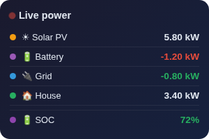

# ioBroker.vis-2-widgets-sigenergy

**Tests:** 

## vis-2-widgets-sigenergy adapter voor ioBroker

VIS-2 widget-set voor de Sigenergy energieopslag-adapter (`ioBroker.sigenergy`).
Bevat 10 widgets voor visualisatie en besturing van energiestroom, batterijstatus, realtime vermogen, dagstatistieken, AC-lader, DC-lader, omvormer, SigenMicro-micro-omvormeroverzicht, PV-strings en laadniveau van het voertuig.

Sinds versie 2.0.0 zijn de widgets een native vis-2-React-widgetset (React 19, MUI 9).

## Vereisten

- ioBroker met geïnstalleerde en geconfigureerde `sigenergy`-adapter
- ioBroker VIS-2 adapter (≥ 2.20.0) — vis-2 2.20 is de eerste versie op basis van React 19 en MUI 9
- De klassieke VIS (vis-1) wordt niet ondersteund

## Bijwerken vanaf 1.x

- Bestaande widgets blijven werken zonder ze opnieuw te plaatsen: de widget-ID's en alle instellingen (object-ID's, titels, donkere modus, namen) zijn dezelfde als voorheen.
- vis-2 moet eerst worden bijgewerkt naar 2.20.0 of nieuwer. Oudere vis-2-versies draaien op React 18 en kunnen deze widgetset niet laden.
- Alle teksten volgen de taal van vis-2 (11 talen). Zelf ingevoerde titels blijven behouden; een lege titel toont de standaardtitel in de taal van de gebruiker.
- De statusuitleg (AC-/DC-lader) verschijnt als knopinfo die niet meer door de widget wordt afgesneden en bij elke widgetgrootte leesbaar blijft.

## Widgets

### Energiestroom-diagram
Toont de huidige energiestroom tussen zonnepanelen, batterij, net en huis als geanimeerd SVG-diagram. Geanimeerde pijlen visualiseren actieve verbindingen in realtime.

**OID's:** `pvPower`, `essPower`, `gridActivePower`, `housePower`, `essSoc`

#### Stroomrichtingen

| Datapunt | Waarde > 0 | Waarde < 0 |
|---|---|---|
| `essPower` | Batterij wordt geladen → pijl van midden naar batterij | Batterij ontlaadt → pijl van batterij naar midden |
| `gridActivePower` | Netafname → pijl van net naar midden | Teruglevering → pijl van midden naar net |
| `pvPower` | PV produceert → pijl van PV naar midden | — |
| `housePower` | Huis verbruikt → pijl van midden naar huis | — |

### Batterijstatus & prognoses
Toont SOC, SOH, laadvermogen en prognoses voor laadtijd, resterende looptijd, eigenverbruik en zelfredzaamheidsgraad.

**OID's:** `essSoc`, `essSoh`, `essPower`, `batteryTimeToFull`, `batteryTimeRemaining`, `selfConsumptionRate`, `autarkyRate`

### Realtime vermogen
Compacte lijstweergave van alle huidige vermogenswaarden met kleurgecodeerde richtingsindicatie.

**OID's:** `pvPower`, `essPower`, `gridActivePower`, `housePower`, `essSoc`

### Energiestatistieken
Dagoverzicht met zelfredzaamheidsgraad, eigenverbruik, SOC-verloop, laad-/ontlaadenergie en batterijdekking.

**OID's:** `autarkyRate`, `selfConsumptionRate`, `dayMaxSoc`, `dayMinSoc`, `essDailyChargeEnergy`, `essDailyDischargeEnergy`, `batteryCoverageToday`, `batteryDailyChargeTime`

### AC-lader (Sigen EVAC)
Bewaking en bediening van de Sigenergy AC-lader (EVAC). Toont laadvermogen, systeemstatus, nominaal vermogen, nominale stroom en totaal energieverbruik. Alarmen worden met kleur gemarkeerd. De statusbadge toont de vereenvoudigde laadstatus volgens IEC 61851-1 (Initialisatie, Vrij, Verbonden, Laden, Fout); bij het aanwijzen met de muis verschijnt een uitgebreide uitleg van de huidige status. De laadstroom is instelbaar via een schuifregelaar (6 A tot de nominale stroom van de lader); de bovengrens kan aanvullend worden begrensd met de widgetinstelling `sig_maxCurrent`. Tijdens actief laden is de Start-knop geblokkeerd en wordt de Stop-knop benadrukt.

**OID's:** `acCharger.systemState`, `acCharger.chargingPower`, `acCharger.totalEnergyConsumed`, `acCharger.ratedPower`, `acCharger.ratedCurrent`, `acCharger.alarm1/2/3`, `acCharger.control.startStop`, `acCharger.control.outputCurrent`

### DC-lader
Bewaking en bediening van de Sigenergy DC-lader. Toont uitgangsvermogen, voertuig-SOC met voortgangsbalk, voertuigbatterijspanning, laadstroom en energie en duur van de huidige laadsessie. De statusbadge toont de bedrijfstoestand van het laadstation (`dcCharger.runningState`: vrij, verbonden/voorbereiding, gepland, laden, ontladen, beëindigd, waarschuwing, fout/niet beschikbaar); bij het aanwijzen met de muis verschijnt een uitgebreide uitleg. Tijdens actief laden of ontladen is de Start-knop geblokkeerd en wordt de Stop-knop benadrukt. Als de status-OID niet is ingesteld, wordt deze afgeleid van de OID van het uitgangsvermogen; zonder statuswaarde valt de badge terug op het uitgangsvermogen en legt de tooltip de reden uit op basis van de door de adapter gedetecteerde protocolversie.

**OID's:** `dcCharger.runningState`, `dcCharger.outputPower`, `dcCharger.vehicleSoc`, `dcCharger.vehicleBatteryVoltage`, `dcCharger.chargingCurrent`, `dcCharger.currentChargingCapacity`, `dcCharger.currentChargingDuration`, `dcCharger.control.startStop`, `info.protocolVersion` (`oid_protocol`)

### Omvormer
Uitgebreide bewaking en bediening van de omvormer met tabnavigatie. Toont bedrijfsstatus, vermogensgegevens, batterijtemperaturen, fasenspanningen, alle 5 alarmregisters en apparaatinformatie (model, serienummer, firmware).

| Tab | Inhoud |
|---|---|
| **Vermogen** | Werkzaam vermogen, PV-vermogen, batterij laad-/ontlaadvermogen, vermogensaandeel-schuifregelaar (−100 % tot +100 %) |
| **Batterij** | SOC en SOH met balken, gem. celtemperatuur/-spanning, max./min. temperatuur |
| **Net** | Fasenspanningen L1/L2/L3, netfrequentie, vermogensfactor, PCS interne temperatuur |
| **Alarmen** | 5 alarmregisters (PCS ×2, ESS, gateway, DC-lader) met hex-code en kleurmarkering |
| **Info** | Modeltype, serienummer, firmwareversie, Remote-EMS-schakelaar |

**OID's:** `inverter.activePower`, `inverter.pvPower`, `inverter.essChargeDischargePower`, `inverter.runningState`, `inverter.essBatterySoc/Soh`, `inverter.essAvgCellTemperature/Voltage`, `inverter.phaseA/B/CVoltage`, `inverter.gridFrequency`, `inverter.pcsInternalTemp`, `inverter.alarm1–5`, `inverter.firmwareVersion`, `inverter.modelType`, `inverter.serialNumber`, `inverter.control.startStop`, `inverter.control.remoteEmsDispatchEnable`, `inverter.control.activePowerPercent`

### PV Power
Weergave van maximaal 3 PV-strings met live vermogenswaarden en geanimeerde stroomspijlen naar de hybride omvormer. Pijlkleuren veranderen dynamisch afhankelijk van het vermogen (oranje <1 kW, geel <2 kW, groen >2 kW).

#### Widget-instellingen
| Parameter | Type | Standaard | Beschrijving |
|---|---|---|---|
| oid_pv1 … oid_pv3 | OID | sigenergy.0.plant.pv1Power … pv3Power | OID's van PV-string-vermogen |
| oid_pvtotal | OID | sigenergy.0.plant.pvPower | Totaal PV-vermogen OID |
| sig_title | tekst | PV Power | Widgettitel |
| sig_name1 … sig_name3 | tekst | String 1 … String 3 | Configureerbare namen per string |
| sig_darkmode | checkbox | true | Donker / Licht modus |

**OIDs:** `plant.pv1Power`, `plant.pv2Power`, `plant.pv3Power`, `plant.pvPower`

### SigenMicro Overzicht
Overzicht en detailweergave van SigenMicro-micro-omvormers. Sinds `ioBroker.sigenergy` 3.5.0 leest de adapter ze via de Sigenergy-cloud (tabblad 'SigenMicro (Cloud)' in de adapterinstellingen) en maakt per micro-omvormer een apparaat aan onder `sigenergy.0.sigenmicro.<serienummer>`. **Vereist `ioBroker.sigenergy` ≥ 3.5.0 met ingeschakelde cloud.** De cloud wordt elke 300 s (OpenAPI) of 60 s (app-interface) bevraagd, sneller kan de widget niet bijwerken.

| Tabblad | Inhoud |
|---|---|
| **Overview** | Alle apparaten als geanimeerde AC-bus met status per apparaat; tegels voor AC-vermogen (adaptertotaal `sigenmicro.totalPower`, anders de som van de apparaten), opbrengst vandaag, totale opbrengst en apparaten online |
| **één tabblad per apparaat** | Afbeelding, naam, nominaal vermogen, serienummer, firmware, tijd van de laatste cloud-update, statusbadge, alle actuele waarden met eenheid en OID, en de door de adapter gemelde PV-ingangen pv1 … pv4 |

#### Status
| Status | Voorwaarde | Weergave |
|---|---|---|
| Producing | `online` = true, `activePower` > 0 | groen, bus geanimeerd |
| Online | `online` = true, `activePower` = 0 | blauw |
| Offline | `online` = false — 's nachts normaal | grijs |
| No data | nog geen waarde ontvangen | grijs |

Als `info.cloudConnection` `false` is, toont de widget de waarschuwing 'Cloud connection lost', omdat de waarden verouderd kunnen zijn.

#### Dynamische lay-out
| Apparaten | Rijen | Afbeeldingsgrootte |
|---|---|---|
| 1–5 | 1 rij | 80 × 90 px |
| 6–10 | 1 rij | 52 × 60 px |
| 11–15 | 2 rijen | 46 × 52 px |
| 16–20 | 2 rijen | 40 × 46 px |

#### Widgetinstellingen
| Parameter | Type | Standaard | Beschrijving |
|---|---|---|---|
| micro_count | getal (1–20) | 3 | Aantal weer te geven micro-omvormers |
| sig_title | tekst | SigenMicro Micro-Inverter | Widgettitel |
| sig_darkmode | checkbox | true | Donkere / lichte modus |
| micro_device1 … micro_device20 | keuzelijst | — | Micro-omvormer uit de lijst van SigenMicro-apparaten van de sigenergy-instanties (serienummer en naam). De widget leest alle states van het apparaat zelf. Widgets uit 1.x behouden hun eerdere state-keuze |
| micro_take_all | knop | — | Neemt alle SigenMicro-apparaten van het account in één keer over (aantal en keuze) |
| micro_name1 … micro_name20 | tekst | — | Weergavenaam van het apparaat (standaard: Micro 01, Micro 02, …) |

**States per apparaat (`sigenergy.0.sigenmicro.<serial>`):**
online, activePower, reactivePower, pvPower, pv1…pv4.voltage / current / power, gridVoltage, gridCurrent, gridFrequency, powerFactor, temperature, insulationResistance, dailyYield, totalYield, serialNumber, firmware, ratedPower, lastUpdate

**Daarnaast:** `sigenergy.0.sigenmicro.totalPower`, `sigenergy.0.info.cloudConnection` — de instantie wordt overgenomen uit de gekozen OID

> **Update vanaf 1.8.x:** de vroegere Modbus-states (`runningState`, `outputPower`, `mppt*`, `modelType` …) bestaan niet meer in de adapter. Kies de micro-omvormers opnieuw in de widgetinstellingen — uit de lijst of met „Alle SigenMicro overnemen”.

### Voertuig laadniveau (EV SOC)
Toont een configureerbaar voertuigafbeelding (bijv. Fiat 500e) als centraal visueel element. Een kleurgecodeerde badge rechtsboven toont een bliksemschicht, het huidige laadniveau in procent en het label "LAADNIVEAU" (vertaald). Een voortgangsbalk onderaan weerspiegelt de huidige SOC. Wanneer de optionele laadstatus actief is, pulseert de badge met een groene gloed.

#### Kleurlogica
| Laadniveau | Kleur |
|---|---|
| ≤ 15 % | Rood (#f87171) |
| ≤ 35 % | Geel (#fbbf24) |
| > 35 % | Groen (#4ade80) |

**OIDs:** `oid_ev_soc`, `oid_charging`

## Weergave

Alle widgets ondersteunen een **lichte en donkere modus**, die kan worden omgeschakeld via de widget-instelling `Donkere modus`. De widgets schalen mee met hun grootte: breedte en hoogte volgen de widget onafhankelijk van elkaar, terwijl de tekst zijn verhoudingen behoudt.

## Changelog
### 2.0.0 (2026-11-17)
* (ssbingo) **Breaking:** de widgets zijn nu een native vis-2-React-widgetset (React 19, MUI 9) en vereisen vis-2 2.20.0 of nieuwer. De klassieke VIS (vis-1) wordt niet meer ondersteund
* (ssbingo) Bestaande widgets blijven werken zonder ze opnieuw te plaatsen: de widget-ID's en alle instellingen zijn ongewijzigd
* (ssbingo) Alle teksten zijn vertaald in de 11 ioBroker-talen (voorheen grotendeels Duits). Ingevoerde titels blijven behouden; een lege titel toont de standaardtitel in de taal van de gebruiker
* (ssbingo) AC-/DC-lader: de statusuitleg is een MUI-knopinfo die niet meer door de widget wordt afgesneden; de laadstroom en het EMS-vermogensaandeel zijn MUI-schuifregelaars die bij het loslaten schrijven
* (ssbingo) Vanuit de vis-2-editor worden geen opdrachten meer verzonden; een klik daar selecteert alleen de widget
* (ssbingo) Energiestroom: de instelling "Geanimeerde stroom" werkt nu
* (ssbingo) SigenMicro: het detailtabblad toont de waarden in drie kolommen, de object-ID op één regel
* (ssbingo) SigenMicro: de micro-omvormers worden in de editor per apparaat (serienummer en naam) gekozen uit de SigenMicro-apparaten van de sigenergy-instanties; de widget leest alle states zelf. Nieuwe knop „Alle SigenMicro overnemen” neemt alle apparaten in één keer over. Widgets uit 1.x blijven werken met hun eerdere state-keuze
* (ssbingo) Gebouwd met Vite en modulefederatie; de widgets zijn getest in vis-2 2.20.11

### 1.9.1 (2026-11-17)
* (ssbingo) vis-2 2.20.x: de widgets passen `box-sizing: border-box` weer zelf toe op hun eigen inhoud. vis-2 2.20 laadt de `CssBaseline` van MUI niet meer, die voorheen het hele document op border-box zette, waardoor kaarten, tegels en knoppen met opvulling breder konden worden dan bedoeld. De regel geldt alleen voor deze widgetset; de set bevat geen React-/MUI-code en draait als klassieke vis-widgetset onder vis-2 2.20 (React 19, MUI 9)

### 1.9.0 (2026-11-17)
* (ssbingo) **SigenMicro-overzicht herzien voor de nieuwe cloudkoppeling van `ioBroker.sigenergy` 3.5.0.** De widget leest nu `sigenergy.0.sigenmicro.<serienummer>.*` (online, activePower, pvPower, PV-ingangen pv1…pv4, netwaarden, temperatuur, isolatieweerstand, opbrengst, firmware, nominaal vermogen, laatste update), het accounttotaal `sigenmicro.totalPower` en `info.cloudConnection`. Het vroegere Modbus-registermodel (`runningState`, `outputPower`, `mppt*`, `modelType`) vervalt
* (ssbingo) SigenMicro: status afgeleid van `online` en het AC-vermogen (Producing / Online / Offline / No data), waarschuwing bij verlies van de cloudverbinding, tijd van de laatste cloud-update en nominaal vermogen in het detailtabblad, PV-ingangen alleen indien gemeld, nieuwe optionele weergavenaam per apparaat (`micro_nameN`), alle widgetteksten in het Engels
* (ssbingo) SigenMicro: de anker-OID mag elke state van de micro-omvormer zijn; afgeleide states worden nu via `vis.conn.subscribe` geabonneerd (VIS abonneert alleen attribuut-OID's) en weer vrijgegeven wanneer de widget wordt verwijderd. **Kies na de update voor elke `oid_microN` opnieuw een state onder `sigenergy.0.sigenmicro.<serienummer>`**
* (ssbingo) CI: Dependabot-auto-merge-workflow bijgewerkt vanuit de ioBroker-sjabloon — gebruikt `pull_request` in plaats van `pull_request_target` (#46, #47); `@iobroker/testing` bijgewerkt van 6.2.1 naar 6.3.1

### 1.8.11 (2026-09-12)
* (ssbingo) CI: de pakkettests draaien nu onder Node.js 22, 24 en 26 (nieuwe job `adapter-tests`, repository checker #41); `@iobroker/testing` bijgewerkt van 5.3.0 naar 6.2.1

### 1.8.10 (2026-09-07)
* (ssbingo) Vermelding `admin` uit `globalDependencies` verwijderd: een widgetset heeft geen admin-interface, dus hoeft geen admin-versie te worden vereist (repository checker S1091)

### 1.8.9 (2026-09-07)
* (ssbingo) DC-lader: een laadstation dat zijn bedrijfstoestandsregister als ongeldig markeert, verschijnt niet langer met een rode badge „Unbekannt”. Het Sigenergy-protocol geeft „register ongeldig” aan door alle bits te zetten, en een SigenStor EC **met** DC-lader antwoordt zo voor register 31513 terwijl de naburige registers (nominaal vermogen, PV-opbrengst, tellers) normaal worden gelezen. De badge wordt dan afgeleid van het uitgangsvermogen en de tooltip maakt duidelijk dat het geen adapter- of configuratieprobleem is
* (ssbingo) DC-lader: ook de ruwe waarde 65535 wordt herkend, zodat de badge ook klopt met adapterversies vóór 3.3.1, die de waarde doorgeven in plaats van geen waarde te melden
* (ssbingo) DC-lader: nieuwe OID-instelling `oid_protocol` (standaard `sigenergy.0.info.protocolVersion`). De protocolversie werd tot nu toe alleen uit het instantievoorvoegsel afgeleid; zo'n OID wordt door VIS niet geabonneerd, `vis.states` bleef leeg en de tooltip beweerde „protocolversie nog niet gedetecteerd”, hoewel de adapter bij de start V2.9 had gedetecteerd. Als gewoon `/id`-attribuut wordt hij zoals elke andere OID geabonneerd
* (ssbingo) DC-lader: als de protocolversie niet leesbaar is, beweert de tooltip niet langer dat er geen is gedetecteerd, maar zegt dat hij hier niet leesbaar is en verwijst naar de nieuwe instelling
* (ssbingo) DC-lader: tooltip herschreven voor het geval de adapter geen toestand meldt hoewel het apparaat protocol V2.8 of nieuwer aangeeft; hij beweert niet langer dat een adapterupdate nodig is, omdat het station zelf het register als ongeldig kan markeren

### 1.8.8 (2026-09-07)
* (ssbingo) DC-lader: als de status-OID niet is ingesteld, wordt deze afgeleid van de OID van het uitgangsvermogen (…dcCharger.outputPower → …dcCharger.runningState), zodat widgets die vóór 1.8.7 zijn geplaatst de bedrijfstoestand zonder aanpassing tonen
* (ssbingo) DC-lader: als er geen bedrijfstoestand beschikbaar is, legt de tooltip de reden uit op basis van de door de adapter gedetecteerde protocolversie (`info.protocolVersion` / `info.protocolLevel`): register 31513 vereist Sigenergy-protocol V2.8; vanaf V2.8 wordt naar het adapterlog of een adapterupdate verwezen; negatief uitgangsvermogen wordt als ontladen weergegeven

### 1.8.7 (2026-09-07)
* (ssbingo) DC-lader: nieuwe status-OID `dcCharger.runningState` (standaard) – de statusbadge toont nu de bedrijfstoestand van het laadstation (vrij, verbonden/voorbereiding, gepland, laden, ontladen, beëindigd, waarschuwing, fout/niet beschikbaar) met een uitgebreide uitleg als tooltip; zonder de OID wordt de badge zoals voorheen uit het uitgangsvermogen afgeleid
* (ssbingo) DC-lader: tijdens actief laden of ontladen is de Start-knop geblokkeerd en wordt de Stop-knop benadrukt; negatief uitgangsvermogen (ontladen) wordt paars weergegeven

### 1.8.6 (2026-09-07)
* (ssbingo) AC-lader: de tooltip op de statusbadge wordt nu als aparte pop-up met vaste lettergrootte en dekkende achtergrond weergegeven, waardoor hij ongeacht de widgetgrootte leesbaar is en niet meer door widgetinhoud wordt overlapt
* (ssbingo) AC-lader: tijdens actief laden is de Start-knop geblokkeerd en wordt de Stop-knop benadrukt
* (ssbingo) De widgetset meldt nu de juiste versie in de browserconsole

### 1.8.5 (2026-09-07)
* (ssbingo) AC-lader: de schuifregelaar voor de laadstroom is nu begrensd tot de nominale stroom van de lader; nieuwe widgetinstelling `sig_maxCurrent` voor een handmatige bovengrens (voorkomt Modbus-fouten bij waarden boven de nominale stroom)
* (ssbingo) AC-lader: de systeemstatus dekt nu alle IEC 61851-1-toestanden (0–7: initialisatie, vrij, verbonden, laden, fout); bij het aanwijzen van de statusbadge verschijnt een uitgebreide uitleg

### 1.8.4 (2026-09-04)
* (ssbingo) Minimale admin-vereiste verlaagd naar >=7.8.23 (admin 8 is niet langer vereist)
* (ssbingo) CI: ioBroker/testing-action-deploy vastgezet op hoofdversie v1; Dependabot auto-merge-workflow gerepareerd
* (ssbingo) Afhankelijkheden bijgewerkt: @tsconfig/node22 22.0.6, @alcalzone/release-script-plugin-license 5.2.2

### 1.8.3 (2026-08-05)
* (ssbingo) Minimumvereisten gedeclareerd: js-controller >=6.0.11, admin >=8.0.0, Node.js >=22
* (ssbingo) Afhankelijkheden bijgewerkt: actions/checkout 7.0.1, ioBroker/testing-action-deploy 1.5.2, @iobroker/testing 5.3.0

### 1.8.2 (2026-06-28)
* (ssbingo) CI-acties bijgewerkt: actions/checkout naar v7.0.0, ioBroker/testing-action-deploy naar v1.5.0

### 1.8.1 (2026-06-08)
* (ssbingo) JSON-syntaxisfout in io-package.json opgelost; widget-screenshot toegevoegd aan documentatie

### 1.8.0 (2026-06-08)
* (ssbingo) Nieuw widget: "Voertuig laadniveau" — toont een configureerbaar EV-afbeelding met geanimeerde SOC-balk, kleurgecodeerd laadniveau (rood/geel/groen) en optionele knipperende laad-badge

### 1.7.9 (2026-05-27)
* (ssbingo) Verouderde .eslintrc.json en .prettierignore verwijderd

### 1.7.8 (2026-05-27)
* (ssbingo) ESLint-linting toegevoegd, CI bijgewerkt naar Node.js 24; adapter vereist node.js >= 22

### 1.7.7 (2026-04-20)
* (ssbingo) Tekst vervormt niet meer bij non-uniforme schaling — letters behouden hun proporties terwijl containers het widget-oppervlak blijven vullen

### 1.7.6 (2026-04-20)
* (ssbingo) Schaling is nu non-uniform: breedte en hoogte reageren onafhankelijk op containerwijzigingen, beide assen blijven afzonderlijk instelbaar

### 1.7.5 (2026-04-20)
* (ssbingo) Widget-schaling reageert nu ook op hoogtewijzigingen — inhoud schaalt proportioneel op beide assen en wordt gecentreerd in de widget

### 1.7.4 (2026-04-20)
* (ssbingo) Alle 9 widgets schalen hun inhoud nu responsief mee met de widget-grootte (lettertypen, padding, SVG, afbeeldingen)

### 1.7.3 (2026-04-20)
* (ssbingo) Alle 9 widgets delen nu een uniforme achtergrond gebaseerd op het PV-Power widget-ontwerp

## Licentie
MIT License

Copyright (c) 2026 ssbingo <s.sternitzke@online.de>

Hierbij wordt gratis toestemming verleend aan elke persoon die een kopie van deze software
en bijbehorende documentatiebestanden (de „Software") verkrijgt, om zonder beperking
gebruik te maken van de Software, met inbegrip van maar niet beperkt tot het recht om
te gebruiken, kopiëren, wijzigen, samenvoegen, publiceren, distribueren, in sublicentie
te geven en/of te verkopen, en om personen aan wie de Software wordt verstrekt, dit toe
te staan, onder de volgende voorwaarden:

De bovenstaande copyrightvermelding en deze toestemmingsvermelding dienen te worden
opgenomen in alle kopieën of substantiële delen van de Software.

DE SOFTWARE WORDT GELEVERD „ZOALS ZIJ IS", ZONDER ENIGE GARANTIE, UITDRUKKELIJK OF
IMPLICIET, INCLUSIEF MAAR NIET BEPERKT TOT DE GARANTIES VAN VERKOOPBAARHEID, GESCHIKTHEID
VOOR EEN BEPAALD DOEL EN NIET-INBREUK.

## Documentatie

- 🇳🇱 [Nederlands](../../doc/nl/README.md) — dit bestand
- 🇩🇪 [Deutsch](../../doc/de/README.md)
- 🇬🇧 [English](../../README.md)
- 🇷🇺 [Русский](../../doc/ru/README.md)
- 🇫🇷 [Français](../../doc/fr/README.md)
- 🇮🇹 [Italiano](../../doc/it/README.md)
- 🇪🇸 [Español](../../doc/es/README.md)
- 🇵🇱 [Polski](../../doc/pl/README.md)
- 🇵🇹 [Português](../../doc/pt/README.md)
