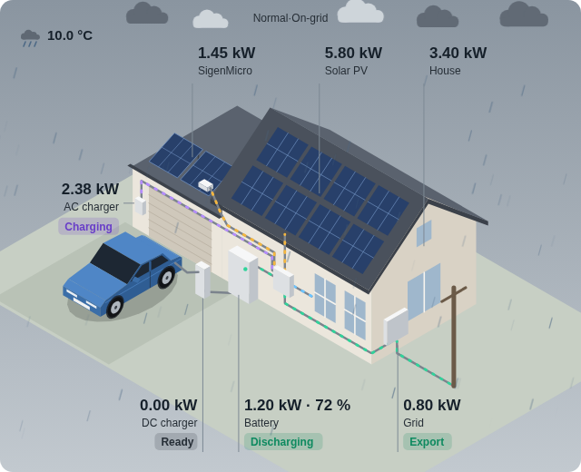
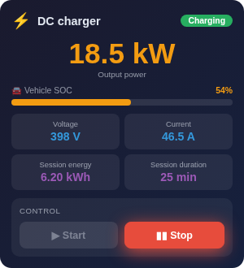

# ioBroker.vis-2-widgets-sigenergy

**Testy:** 

## Adapter vis-2-widgets-sigenergy dla ioBroker

Zestaw widżetów VIS-2 dla adaptera magazynowania energii Sigenergy (`ioBroker.sigenergy`).
Zawiera 11 widżetów do wizualizacji i sterowania przepływem energii, domem energii, stanem baterii, mocą w czasie rzeczywistym, statystykami dziennymi, ładowarką AC, ładowarką DC, falownikiem, przeglądem mikrofalowników SigenMicro, łańcuchami PV i poziomem naładowania pojazdu.

Od wersji 2.0.0 widżety są natywnym zestawem widżetów React dla vis-2 (React 19, MUI 9).

## Wymagania

- ioBroker z zainstalowanym i skonfigurowanym adapterem `sigenergy`
- Adapter ioBroker VIS-2 (≥ 2.20.0) — vis-2 2.20 to pierwsza wersja oparta na React 19 i MUI 9
- Klasyczna VIS (vis-1) nie jest obsługiwana

## Aktualizacja z wersji 1.x

- Istniejące widżety działają dalej bez ponownego umieszczania: identyfikatory widżetów i wszystkie ustawienia (identyfikatory obiektów, tytuły, tryb ciemny, nazwy) pozostają takie same jak dotychczas.
- Najpierw należy zaktualizować vis-2 do wersji 2.20.0 lub nowszej. Starsze wersje vis-2 działają na React 18 i nie mogą załadować tego zestawu widżetów.
- Wszystkie teksty są wyświetlane w języku vis-2 (11 języków). Samodzielnie wpisane tytuły zostają zachowane; pusty tytuł wyświetla domyślny tytuł w języku użytkownika.
- Objaśnienia stanu (ładowarka AC/DC) są wyświetlane jako podpowiedź, która nie jest już przycinana przez widżet i pozostaje czytelna przy każdym rozmiarze widżetu.

## Widżety

### Diagram przepływu energii
Wyświetla aktualny przepływ energii między panelami słonecznymi, baterią, siecią i domem jako animowany diagram SVG.
Animowane strzałki wizualizują aktywne połączenia w czasie rzeczywistym.

**OID:** `pvPower`, `essPower`, `gridActivePower`, `housePower`, `essSoc`

#### Kierunki przepływu

| Punkt danych | Wartość > 0 | Wartość < 0 |
|---|---|---|
| `essPower` | Bateria ładuje się → strzałka od środka do baterii | Bateria rozładowuje się → strzałka od baterii do środka |
| `gridActivePower` | Pobór z sieci → strzałka od sieci do środka | Oddawanie do sieci → strzałka od środka do sieci |
| `pvPower` | PV produkuje → strzałka od PV do środka | — |
| `housePower` | Dom zużywa → strzałka od środka do domu | — |

### Dom energii
Pokazuje przepływ energii jako izometryczny dom z garażem, samochodem i urządzeniami Sigenergy: PV na dachu, bateria SigenStor i bramka na ścianie domu, wallbox AC na garażu, ładowarka DC przed nim, elektrownia balkonowa z SigenMicro na dachu garażu oraz przyłącze sieciowe. Animowane kreski biegną wzdłuż przewodów w kierunku przepływu energii, tym szybciej, im większa moc. Dzień i noc podążają za słońcem w lokalizacji z ustawień systemowych ioBroker. Całość jest rysowana jako grafika wektorowa, dlatego widżet pozostaje ostry w każdym rozmiarze i zachowuje proporcje.

**OIDs:** `pvPower`, `housePower`, `essPower`, `essSoc`, `gridActivePower`, `acCharger.chargingPower`, `acCharger.systemState`, `dcCharger.outputPower`, `dcCharger.runningState`, `sigenmicro.totalPower`; opcjonalnie: temperatura zewnętrzna (`oid_temp`) i tekst statusu (`oid_status`)

| Ustawienie | Domyślnie | Opis |
|---|---|---|
| sig_daynight | Automatycznie | Automatycznie (położenie słońca), zawsze dzień lub zawsze noc |
| sig_animation | wł. | Animowany przepływ wzdłuż przewodów |
| `sig_show_garage`, `sig_show_car`, `sig_show_ac`, `sig_show_dc`, `sig_show_micro` | wł. | Pokazuje lub ukrywa garaż, samochód, ładowarkę AC, ładowarkę DC i elektrownię balkonową. Elektrownia balkonowa wymaga garażu; bez garażu wallbox AC wisi na ścianie domu |

**Pogoda (opcjonalnie):** z punktem danych pogody niebo odpowiada prawdziwej pogodzie — słońce, chmury, deszcz, śnieg, mgła lub burza; bez niego pozostaje bezchmurne. Używany jest niezależny od języka kod adaptera pogody; angielskie teksty pogodowe są również rozpoznawane.

| Adapter | Warunki pogodowe | Zachmurzenie (%) | Opady (mm/h) | Liczbowy kod pogody |
|---|---|---|---|---|
| open-meteo-weather | `…weather.current.weather_code` | `…weather.current.cloud_cover` | `…weather.current.precipitation` | Automatycznie |
| openweathermap | `forecast.current.icon` | `forecast.current.clouds` | `forecast.current.precipitation` | Automatycznie |
| daswetter | `location_1.ForecastHourly.Current.symbol` | `…Current.clouds` | `…Current.rain` | Symbol DasWetter |

daswetter zapisuje kanał `Current` tylko z opcją kopiowania bieżącej godziny; w przeciwnym razie użyj `ForecastHourly.Hour_1`. Działa też `symbol_URL`, z kodem pogody ustawionym na Automatycznie.

Zachmurzenie i opady uściślają warunki lub je zastępują; opady przy 1 °C lub mniej rysowane są jako śnieg.

### Stan baterii i prognozy
Wyświetla SOC, SOH, moc ładowania oraz prognozy czasu do pełnego naładowania, pozostałego czasu pracy, autokonsumpcji i stopnia autarki.

**OID:** `essSoc`, `essSoh`, `essPower`, `batteryTimeToFull`, `batteryTimeRemaining`, `selfConsumptionRate`, `autarkyRate`

### Moc w czasie rzeczywistym
Kompaktowy widok listy wszystkich aktualnych wartości mocy z kolorowo zakodowanymi wskaźnikami kierunku.

**OID:** `pvPower`, `essPower`, `gridActivePower`, `housePower`, `essSoc`

### Statystyki energii
Dzienny przegląd ze stopniem autarki, autokonsumpcją, historią SOC, energią ładowania/rozładowania i pokryciem baterii.

**OID:** `autarkyRate`, `selfConsumptionRate`, `dayMaxSoc`, `dayMinSoc`, `essDailyChargeEnergy`, `essDailyDischargeEnergy`, `batteryCoverageToday`, `batteryDailyChargeTime`

### Ładowarka AC (Sigen EVAC)
Monitorowanie i sterowanie ładowarką AC Sigenergy (EVAC). Wyświetla moc ładowania, stan systemu, moc znamionową, prąd znamionowy i całkowite zużycie energii. Alarmy są wyróżnione kolorami. Plakietka stanu pokazuje uproszczony stan ładowania według IEC 61851-1 (Inicjalizacja, Wolny, Podłączony, Ładowanie, Błąd); po najechaniu myszą wyświetlane jest szczegółowe objaśnienie bieżącego stanu. Prąd ładowania można regulować suwakiem (od 6 A do prądu znamionowego ładowarki); górną granicę można dodatkowo ograniczyć ustawieniem widżetu `sig_maxCurrent`. Podczas aktywnego ładowania przycisk Start jest zablokowany, a przycisk Stop wyróżniony.

**OID:** `acCharger.systemState`, `acCharger.chargingPower`, `acCharger.totalEnergyConsumed`, `acCharger.ratedPower`, `acCharger.ratedCurrent`, `acCharger.alarm1/2/3`, `acCharger.control.startStop`, `acCharger.control.outputCurrent`

### Ładowarka DC
Monitorowanie i sterowanie ładowarką DC Sigenergy. Wyświetla moc wyjściową, SOC pojazdu z paskiem postępu, napięcie baterii pojazdu, prąd ładowania oraz energię i czas trwania bieżącej sesji ładowania. Plakietka stanu pokazuje stan pracy stacji ładowania (`dcCharger.runningState`: wolna, podłączony/przygotowanie, zaplanowane, ładowanie, rozładowywanie, zakończone, ostrzeżenie, błąd/niedostępna); po najechaniu myszą wyświetlane jest szczegółowe objaśnienie. Podczas aktywnego ładowania lub rozładowywania przycisk Start jest zablokowany, a przycisk Stop wyróżniony. Jeśli OID stanu nie jest ustawiony, jest wyprowadzany z OID mocy wyjściowej; bez wartości stanu plakietka opiera się na mocy wyjściowej, a podpowiedź wyjaśnia przyczynę w zależności od wersji protokołu wykrytej przez adapter.

**OID:** `dcCharger.runningState`, `dcCharger.outputPower`, `dcCharger.vehicleSoc`, `dcCharger.vehicleBatteryVoltage`, `dcCharger.chargingCurrent`, `dcCharger.currentChargingCapacity`, `dcCharger.currentChargingDuration`, `dcCharger.control.startStop`, `info.protocolVersion` (`oid_protocol`)

### Falownik
Kompleksowe monitorowanie i sterowanie falownikiem z nawigacją zakładkową. Wyświetla stan pracy, dane mocy, temperatury baterii, napięcia fazowe, wszystkie 5 rejestrów alarmów oraz informacje o urządzeniu (model, numer seryjny, firmware).

| Zakładka | Zawartość |
|---|---|
| **Moc** | Moc czynna, moc PV, moc ładowania/rozładowania baterii, suwak udziału mocy (od −100 % do +100 %) |
| **Bateria** | SOC i SOH z paskami, śr. temperatura/napięcie ogniw, temperatura maks./min. |
| **Sieć** | Napięcia fazowe L1/L2/L3, częstotliwość sieci, współczynnik mocy, temperatura wewnętrzna PCS |
| **Alarmy** | 5 rejestrów alarmów (PCS ×2, ESS, brama, ładowarka DC) z kodem hex i oznaczeniem kolorystycznym |
| **Info** | Typ modelu, numer seryjny, wersja firmware, przełącznik Remote-EMS |

**OID:** `inverter.activePower`, `inverter.pvPower`, `inverter.essChargeDischargePower`, `inverter.runningState`, `inverter.essBatterySoc/Soh`, `inverter.essAvgCellTemperature/Voltage`, `inverter.phaseA/B/CVoltage`, `inverter.gridFrequency`, `inverter.pcsInternalTemp`, `inverter.alarm1–5`, `inverter.firmwareVersion`, `inverter.modelType`, `inverter.serialNumber`, `inverter.control.startStop`, `inverter.control.remoteEmsDispatchEnable`, `inverter.control.activePowerPercent`

### PV Power
Wyświetlanie do 3 ciągów PV z wartościami mocy na żywo oraz animowanymi strzałkami przepływu do inwertera hybrydowego. Kolory strzałek zmieniają się dynamicznie w zależności od mocy (pomarańczowy <1 kW, żółty <2 kW, zielony >2 kW).

#### Ustawienia widżetu
| Parametr | Typ | Domyślnie | Opis |
|---|---|---|---|
| oid_pv1 … oid_pv3 | OID | sigenergy.0.plant.pv1Power … pv3Power | OID mocy na ciąg PV |
| oid_pvtotal | OID | sigenergy.0.plant.pvPower | OID całkowitej mocy PV |
| sig_title | tekst | PV Power | Tytuł widżetu |
| sig_name1 … sig_name3 | tekst | String 1 … String 3 | Konfigurowalne nazwy ciągów |
| sig_darkmode | checkbox | true | Tryb ciemny / jasny |

**OIDs:** `plant.pv1Power`, `plant.pv2Power`, `plant.pv3Power`, `plant.pvPower`

### Przegląd SigenMicro
Przegląd i widok szczegółowy mikrofalowników SigenMicro. Od wersji 3.5.0 `ioBroker.sigenergy` adapter odczytuje je przez chmurę Sigenergy (karta „SigenMicro (Cloud)” w ustawieniach adaptera) i tworzy dla każdego mikrofalownika urządzenie w `sigenergy.0.sigenmicro.<numer seryjny>`. **Wymaga `ioBroker.sigenergy` ≥ 3.5.0 z włączoną chmurą.** Chmura jest odpytywana co 300 s (OpenAPI) lub co 60 s (interfejs aplikacji), więc widżet nie może odświeżać się szybciej.

| Karta | Zawartość |
|---|---|
| **Overview** | Wszystkie urządzenia jako animowana szyna AC ze stanem każdego urządzenia; kafelki mocy AC (suma adaptera `sigenmicro.totalPower`, w przeciwnym razie suma urządzeń), uzysku dziennego, uzysku całkowitego i liczby urządzeń online |
| **jedna karta na urządzenie** | Obraz, nazwa, moc znamionowa, numer seryjny, oprogramowanie, czas ostatniej aktualizacji z chmury, plakietka stanu, wszystkie bieżące wartości z jednostką i OID oraz zgłaszane przez adapter wejścia PV pv1 … pv4 |

#### Stan
| Stan | Warunek | Wyświetlanie |
|---|---|---|
| Producing | `online` = true, `activePower` > 0 | zielony, szyna animowana |
| Online | `online` = true, `activePower` = 0 | niebieski |
| Offline | `online` = false — w nocy to normalne | szary |
| No data | nie odebrano jeszcze wartości | szary |

Jeśli `info.cloudConnection` ma wartość `false`, widżet wyświetla ostrzeżenie „Cloud connection lost”, ponieważ wartości mogą być nieaktualne.

#### Układ dynamiczny
| Urządzenia | Rzędy | Rozmiar obrazu |
|---|---|---|
| 1–5 | 1 rząd | 80 × 90 px |
| 6–10 | 1 rząd | 52 × 60 px |
| 11–15 | 2 rzędy | 46 × 52 px |
| 16–20 | 2 rzędy | 40 × 46 px |

#### Ustawienia widżetu
| Parametr | Typ | Domyślnie | Opis |
|---|---|---|---|
| micro_count | liczba (1–20) | 3 | Liczba wyświetlanych mikrofalowników |
| sig_title | tekst | SigenMicro Micro-Inverter | Tytuł widżetu |
| sig_darkmode | checkbox | true | Tryb ciemny / jasny |
| micro_device1 … micro_device20 | wybór | — | Mikrofalownik z listy urządzeń SigenMicro instancji sigenergy (numer seryjny i nazwa). Widżet sam odczytuje wszystkie stany urządzenia. Widżety z 1.x zachowują dotychczasowy wybór stanu |
| micro_take_all | przycisk | — | Przejmuje naraz wszystkie urządzenia SigenMicro konta (liczbę i wybór) |
| micro_name1 … micro_name20 | tekst | — | Wyświetlana nazwa urządzenia (domyślnie: Micro 01, Micro 02, …) |

**Stany urządzenia (`sigenergy.0.sigenmicro.<serial>`):**
online, activePower, reactivePower, pvPower, pv1…pv4.voltage / current / power, gridVoltage, gridCurrent, gridFrequency, powerFactor, temperature, insulationResistance, dailyYield, totalYield, serialNumber, firmware, ratedPower, lastUpdate

**Dodatkowo:** `sigenergy.0.sigenmicro.totalPower`, `sigenergy.0.info.cloudConnection` — instancja jest przejmowana z wybranego OID

> **Aktualizacja z 1.8.x:** dawnych stanów Modbus (`runningState`, `outputPower`, `mppt*`, `modelType` …) nie ma już w adapterze. Wybierz ponownie mikrofalowniki w ustawieniach widżetu — z listy lub przyciskiem „Przejmij wszystkie SigenMicro”.

### Poziom naładowania pojazdu (EV SOC)
Wyświetla konfigurowalne zdjęcie pojazdu (np. Fiat 500e) jako centralny element wizualny. Kolorowa odznaka w prawym górnym rogu pokazuje symbol błyskawicy, aktualny poziom naładowania w procentach i etykietę „NAŁADOWANIE" (przetłumaczona). Pasek postępu na dole odzwierciedla aktualny SOC. Gdy opcjonalny stan ładowania jest aktywny, odznaka pulsuje zielonym blaskiem.

#### Logika kolorów
| Poziom naładowania | Kolor |
|---|---|
| ≤ 15 % | Czerwony (#f87171) |
| ≤ 35 % | Żółty (#fbbf24) |
| > 35 % | Zielony (#4ade80) |

**OIDs:** `oid_ev_soc`, `oid_charging`

## Wygląd

Wszystkie widżety obsługują **tryb jasny i ciemny**, przełączany przez ustawienie widżetu `Tryb ciemny`. Widżety skalują się wraz ze swoim rozmiarem: szerokość i wysokość dopasowują się do widżetu niezależnie od siebie, a tekst zachowuje swoje proporcje.

## Changelog
### 2.2.0 (2026-11-18)
* (ssbingo) **Dom energii pokazuje prawdziwą pogodę:** z punktem danych pogody (kod WMO z open-meteo-weather, ikona lub id OpenWeatherMap, symbol DasWetter, ikona AccuWeather lub tekst angielski), opcjonalnie zachmurzenie i opady, niebo pokazuje słońce, chmury, deszcz, śnieg, mgłę lub burzę zamiast zawsze słońca; symbol obok temperatury odpowiada pogodzie

### 2.1.0 (2026-11-18)
* (ssbingo) **Nowy widżet „Dom energii”:** przepływ energii jako izometryczny dom z garażem, samochodem, PV na dachu, SigenStor i bramką na ścianie, wallboxem AC, ładowarką DC, elektrownią balkonową z SigenMicro na dachu garażu i przyłączem sieciowym; animowane przewody w kierunku przepływu, dzień i noc według położenia słońca, opcjonalnie temperatura zewnętrzna i tekst statusu, każdą część można ukryć

### 2.0.2 (2026-11-18)
* (ssbingo) SigenMicro: nowy pasek kart — „Przegląd” zachowuje swoją szerokość, karty urządzeń dzielą resztę na równe kolumny i nie wychodzą już poza widżet; do 3 urządzeń karty pokazują nazwy, przy większej liczbie kompaktowe numery 01, 02 … (jak przy węzłach, nazwa jako podpowiedź); powyżej 10 urządzeń dwa wiersze jak węzły
* (ssbingo) SigenMicro: etykiety znajdują się dokładnie pod swoimi węzłami, każdy wiersz etykiet bezpośrednio pod swoim wierszem węzłów; kliknięcie węzła lub etykiety otwiera kartę szczegółów urządzenia; lepszy kontrast tekstów kafelków; jeśli kilka wybranych urządzeń zgłasza tę samą nazwę, wyświetlany jest numer seryjny
* (ssbingo) Rozciągnięte widżety: teksty nie są już ściskane podwójnie, teksty wyśrodkowane pozostają wyśrodkowane, a tytuły ładowarek AC/DC, falownika i baterii oraz znaczek stanu i nagłówek sekcji SigenMicro zachowują proporcje

### 2.0.1 (2026-11-17)
* (ssbingo) Odnowione zrzuty ekranu w README: wszystkie widżety w postaci wyświetlanej przez zestaw widżetów React w vis-2 2.20, z tekstami w języku angielskim
* (ssbingo) Zaktualizowano zależności (vite 7.3.8, `@iobroker/gui-components` 10.4.6, `@iobroker/testing` 6.3.2)

### 2.0.0 (2026-11-17)
* (ssbingo) **Breaking:** widżety są teraz natywnym zestawem widżetów React dla vis-2 (React 19, MUI 9) i wymagają vis-2 2.20.0 lub nowszego. Klasyczna VIS (vis-1) nie jest już obsługiwana
* (ssbingo) Istniejące widżety działają dalej bez ponownego umieszczania: identyfikatory widżetów i wszystkie ustawienia pozostały bez zmian
* (ssbingo) Wszystkie teksty są przetłumaczone na 11 języków ioBroker (wcześniej głównie po niemiecku). Wpisane tytuły zostają zachowane; pusty tytuł wyświetla domyślny tytuł w języku użytkownika
* (ssbingo) Ładowarka AC/DC: objaśnienie stanu jest podpowiedzią MUI, która nie jest już przycinana przez widżet; prąd ładowania i udział mocy EMS to suwaki MUI, które zapisują wartość po zwolnieniu
* (ssbingo) Edytor vis-2 nie wysyła już żadnych poleceń; kliknięcie w nim jedynie zaznacza widżet
* (ssbingo) Przepływ energii: ustawienie „Animowany przepływ” teraz działa
* (ssbingo) SigenMicro: zakładka szczegółów pokazuje wartości w trzech kolumnach, a identyfikator obiektu w jednym wierszu
* (ssbingo) SigenMicro: mikrofalowniki wybiera się w edytorze według urządzenia (numer seryjny i nazwa) spośród urządzeń SigenMicro instancji sigenergy; widżet sam odczytuje wszystkie stany. Nowy przycisk „Przejmij wszystkie SigenMicro” przejmuje naraz wszystkie urządzenia. Widżety z 1.x działają dalej z dotychczasowym wyborem stanu
* (ssbingo) Kompilacja za pomocą Vite i federacji modułów; widżety zostały przetestowane w vis-2 2.20.11

### 1.9.1 (2026-11-17)
* (ssbingo) vis-2 2.20.x: widżety znów same ustawiają `box-sizing: border-box` dla własnej zawartości. vis-2 2.20 nie ładuje już `CssBaseline` z MUI, który wcześniej przełączał cały dokument na border-box, przez co karty, kafelki i przyciski z wypełnieniem mogły być szersze niż zaplanowano. Reguła dotyczy tylko tego zestawu widżetów; zestaw nie zawiera kodu React/MUI i działa jako klasyczny zestaw widżetów vis w vis-2 2.20 (React 19, MUI 9)

### 1.9.0 (2026-11-17)
* (ssbingo) **Przegląd SigenMicro przebudowany pod nowe połączenie z chmurą w `ioBroker.sigenergy` 3.5.0.** Widżet odczytuje teraz `sigenergy.0.sigenmicro.<numer seryjny>.*` (online, activePower, pvPower, wejścia PV pv1…pv4, parametry sieci, temperatura, rezystancja izolacji, uzysk, oprogramowanie, moc znamionowa, ostatnia aktualizacja), sumę konta `sigenmicro.totalPower` oraz `info.cloudConnection`. Dotychczasowy model rejestrów Modbus (`runningState`, `outputPower`, `mppt*`, `modelType`) został usunięty
* (ssbingo) SigenMicro: stan wyznaczany z `online` i mocy AC (Producing / Online / Offline / No data), ostrzeżenie przy utracie połączenia z chmurą, czas ostatniej aktualizacji z chmury i moc znamionowa w karcie szczegółów, wejścia PV wyświetlane tylko, gdy są zgłaszane, nowa opcjonalna nazwa wyświetlana dla każdego urządzenia (`micro_nameN`), wszystkie teksty widżetu po angielsku
* (ssbingo) SigenMicro: kotwicą OID może być dowolny stan mikrofalownika; stany pochodne są teraz subskrybowane przez `vis.conn.subscribe` (VIS subskrybuje tylko OID z atrybutów) i zwalniane po usunięciu widżetu. **Po aktualizacji należy ponownie wybrać dla każdego `oid_microN` stan w `sigenergy.0.sigenmicro.<numer seryjny>`**
* (ssbingo) CI: workflow automatycznego scalania Dependabot zaktualizowany z szablonu ioBroker — używa `pull_request` zamiast `pull_request_target` (#46, #47); `@iobroker/testing` zaktualizowany z 6.2.1 do 6.3.1

### 1.8.11 (2026-09-12)
* (ssbingo) CI: testy pakietu działają teraz pod Node.js 22, 24 i 26 (nowe zadanie `adapter-tests`, repository checker #41); `@iobroker/testing` zaktualizowano z 5.3.0 do 6.2.1

### 1.8.10 (2026-09-07)
* (ssbingo) Usunięto wpis `admin` z `globalDependencies`: zestaw widżetów nie ma interfejsu administracyjnego, więc nie trzeba wymagać żadnej wersji admin (repository checker S1091)

### 1.8.9 (2026-09-07)
* (ssbingo) Ładowarka DC: stacja, która oznacza rejestr stanu pracy jako nieprawidłowy, nie jest już wyświetlana z czerwoną plakietką „Unbekannt”. Protokół Sigenergy sygnalizuje „rejestr nieprawidłowy” przez ustawienie wszystkich bitów, a SigenStor EC **z** ładowarką DC odpowiada tak dla rejestru 31513, podczas gdy sąsiednie rejestry (moc znamionowa, uzysk PV, liczniki) są odczytywane normalnie. Plakietka jest wtedy wyprowadzana z mocy wyjściowej, a podpowiedź wyjaśnia, że nie jest to problem adaptera ani konfiguracji
* (ssbingo) Ładowarka DC: rozpoznawana jest również surowa wartość 65535, dzięki czemu plakietka jest poprawna także z wersjami adaptera sprzed 3.3.1, które przekazują tę wartość zamiast nie zgłaszać żadnej
* (ssbingo) Ładowarka DC: nowe ustawienie OID `oid_protocol` (domyślnie `sigenergy.0.info.protocolVersion`). Wersja protokołu była dotąd wyprowadzana tylko z prefiksu instancji; VIS nie subskrybuje takiego OID, `vis.states` pozostawało puste, a podpowiedź twierdziła „wersja protokołu jeszcze nie wykryta”, mimo że adapter wykrył V2.9 przy starcie. Zadeklarowana jako zwykły atrybut `/id` jest subskrybowana jak każdy inny OID
* (ssbingo) Ładowarka DC: gdy wersji protokołu nie można odczytać, podpowiedź nie twierdzi już, że żadnej nie wykryto, lecz informuje, że nie jest tu odczytywalna, i wskazuje na nowe ustawienie
* (ssbingo) Ładowarka DC: przeredagowano podpowiedź wyświetlaną, gdy adapter nie zgłasza stanu, choć urządzenie deklaruje protokół V2.8 lub nowszy; nie twierdzi już, że potrzebna jest aktualizacja adaptera, ponieważ sama stacja może oznaczyć rejestr jako nieprawidłowy

### 1.8.8 (2026-09-07)
* (ssbingo) Ładowarka DC: jeśli OID stanu nie jest ustawiony, jest wyprowadzany z OID mocy wyjściowej (…dcCharger.outputPower → …dcCharger.runningState), dzięki czemu widżety umieszczone przed 1.8.7 pokazują stan pracy bez edycji
* (ssbingo) Ładowarka DC: gdy stan pracy jest niedostępny, podpowiedź wyjaśnia przyczynę w zależności od wersji protokołu wykrytej przez adapter (`info.protocolVersion` / `info.protocolLevel`): rejestr 31513 wymaga protokołu Sigenergy V2.8; od V2.8 odsyła do logu adaptera lub aktualizacji adaptera; ujemna moc wyjściowa jest wyświetlana jako rozładowywanie

### 1.8.7 (2026-09-07)
* (ssbingo) Ładowarka DC: nowy OID stanu `dcCharger.runningState` (domyślny) – plakietka stanu pokazuje teraz stan pracy stacji ładowania (wolna, podłączony/przygotowanie, zaplanowane, ładowanie, rozładowywanie, zakończone, ostrzeżenie, błąd/niedostępna) ze szczegółowym objaśnieniem jako podpowiedź; bez OID plakietka jest jak dotychczas wyprowadzana z mocy wyjściowej
* (ssbingo) Ładowarka DC: podczas aktywnego ładowania lub rozładowywania przycisk Start jest zablokowany, a przycisk Stop wyróżniony; ujemna moc wyjściowa (rozładowywanie) jest wyświetlana na fioletowo

### 1.8.6 (2026-09-07)
* (ssbingo) Ładowarka AC: podpowiedź na plakietce stanu jest teraz wyświetlana jako osobne okienko ze stałym rozmiarem czcionki i nieprzezroczystym tłem, dzięki czemu jest czytelna niezależnie od rozmiaru widżetu i nie jest już zasłaniana przez zawartość widżetu
* (ssbingo) Ładowarka AC: podczas aktywnego ładowania przycisk Start jest zablokowany, a przycisk Stop wyróżniony
* (ssbingo) Zestaw widżetów zgłasza teraz poprawną wersję w konsoli przeglądarki

### 1.8.5 (2026-09-07)
* (ssbingo) Ładowarka AC: suwak prądu ładowania jest teraz ograniczony do prądu znamionowego ładowarki; nowe ustawienie widżetu `sig_maxCurrent` dla ręcznej górnej granicy (zapobiega błędom Modbus przy ustawianiu wartości powyżej prądu znamionowego)
* (ssbingo) Ładowarka AC: stan systemu obejmuje teraz wszystkie stany IEC 61851-1 (0–7: inicjalizacja, wolny, podłączony, ładowanie, błąd); po najechaniu na plakietkę stanu wyświetlane jest szczegółowe objaśnienie

### 1.8.4 (2026-09-04)
* (ssbingo) Minimalne wymaganie admin obniżone do >=7.8.23 (admin 8 nie jest już wymagany)
* (ssbingo) CI: ioBroker/testing-action-deploy przypięty do wersji głównej v1; naprawiono workflow auto-merge Dependabota
* (ssbingo) Zaktualizowano zależności: @tsconfig/node22 22.0.6, @alcalzone/release-script-plugin-license 5.2.2

### 1.8.3 (2026-08-05)
* (ssbingo) Zadeklarowano minimalne wymagania: js-controller >=6.0.11, admin >=8.0.0, Node.js >=22
* (ssbingo) Zaktualizowano zależności: actions/checkout 7.0.1, ioBroker/testing-action-deploy 1.5.2, @iobroker/testing 5.3.0

### 1.8.2 (2026-06-28)
* (ssbingo) Zaktualizowano akcje CI: actions/checkout do v7.0.0, ioBroker/testing-action-deploy do v1.5.0

### 1.8.1 (2026-06-08)
* (ssbingo) Naprawiono błąd składni JSON w io-package.json; zrzut ekranu widżetu dodany do dokumentacji

### 1.8.0 (2026-06-08)
* (ssbingo) Nowy widżet: "Poziom naładowania pojazdu" — wyświetla konfigurowalne zdjęcie pojazdu elektrycznego z animowanym paskiem SOC, kolorowym poziomem naładowania (czerwony/żółty/zielony) i opcjonalną migającą odznaką ładowania

### 1.7.9 (2026-05-27)
* (ssbingo) Usunięto przestarzałe .eslintrc.json i .prettierignore

### 1.7.8 (2026-05-27)
* (ssbingo) Dodano ESLint, CI zaktualizowano do Node.js 24; adapter wymaga node.js >= 22

### 1.7.7 (2026-04-20)
* (ssbingo) Tekst nie zniekształca się już przy nierównomiernym skalowaniu — litery zachowują proporcje, a kontenery nadal wypełniają obszar widżetu

### 1.7.6 (2026-04-20)
* (ssbingo) Skalowanie jest teraz nierównomierne: szerokość i wysokość reagują niezależnie na zmiany kontenera, obie osie pozostają regulowane osobno

### 1.7.5 (2026-04-20)
* (ssbingo) Skalowanie widżetów reaguje teraz również na zmiany wysokości — zawartość skaluje się proporcjonalnie na obu osiach i jest wyśrodkowana w widżecie

### 1.7.4 (2026-04-20)
* (ssbingo) Wszystkie 9 widżetów teraz responsywnie skaluje swoją zawartość wraz z rozmiarem widżetu (czcionki, odstępy, SVG, obrazy)

### 1.7.3 (2026-04-20)
* (ssbingo) Wszystkie 9 widżetów ma teraz ujednolicone tło oparte na projekcie widżetu PV-Power

## Licencja
MIT License

Copyright (c) 2026 ssbingo <s.sternitzke@online.de>

Niniejszym udziela się bezpłatnego zezwolenia każdej osobie, która uzyska kopię
tego oprogramowania i powiązanych plików dokumentacji (dalej „Oprogramowanie"),
na używanie Oprogramowania bez ograniczeń, w tym bez ograniczeń prawa do używania,
kopiowania, modyfikowania, scalania, publikowania, dystrybucji, udzielania sublicencji
i/lub sprzedaży kopii Oprogramowania, pod następującymi warunkami:

Powyższe zastrzeżenie praw autorskich oraz niniejsza informacja o zezwoleniu muszą być
zawarte we wszystkich kopiach lub istotnych częściach Oprogramowania.

OPROGRAMOWANIE JEST DOSTARCZANE „TAK JAK JEST", BEZ JAKIEJKOLWIEK GWARANCJI, WYRAŹNEJ
LUB DOROZUMIANEJ, W TYM BEZ GWARANCJI PRZYDATNOŚCI HANDLOWEJ, PRZYDATNOŚCI DO OKREŚLONEGO
CELU I NIENARUSZANIA PRAW.

## Dokumentacja

- 🇵🇱 [Polski](../../doc/pl/README.md) — ten plik
- 🇩🇪 [Deutsch](../../doc/de/README.md)
- 🇬🇧 [English](../../README.md)
- 🇷🇺 [Русский](../../doc/ru/README.md)
- 🇳🇱 [Nederlands](../../doc/nl/README.md)
- 🇫🇷 [Français](../../doc/fr/README.md)
- 🇮🇹 [Italiano](../../doc/it/README.md)
- 🇪🇸 [Español](../../doc/es/README.md)
- 🇵🇹 [Português](../../doc/pt/README.md)
