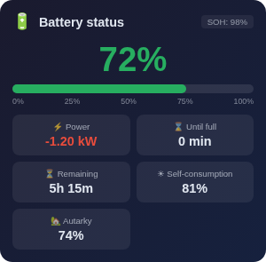
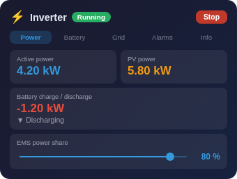

# ioBroker.vis-2-widgets-sigenergy

**Testes:** 

## Adaptador vis-2-widgets-sigenergy para ioBroker

Conjunto de widgets VIS-2 para o adaptador de armazenamento de energia Sigenergy (`ioBroker.sigenergy`).
Contém 11 widgets para visualização e controlo do fluxo de energia, casa de energia, estado da bateria, potência em tempo real, estatísticas diárias, carregador AC, carregador DC, inversor, visão geral dos micro-inversores SigenMicro, strings fotovoltaicas e nível de carga do veículo.

Desde a versão 2.0.0, os widgets são um conjunto de widgets React nativo do vis-2 (React 19, MUI 9).

## Requisitos

- ioBroker com o adaptador `sigenergy` instalado e configurado
- Adaptador ioBroker VIS-2 (≥ 2.20.0) — o vis-2 2.20 é a primeira versão baseada em React 19 e MUI 9
- O VIS clássico (vis-1) não é suportado

## Atualização a partir da 1.x

- Os widgets existentes continuam a funcionar sem ser necessário colocá-los novamente: os IDs dos widgets e todas as definições (IDs de objeto, títulos, modo escuro, nomes) são os mesmos de antes.
- O vis-2 tem de ser atualizado primeiro para a versão 2.20.0 ou mais recente. As versões anteriores do vis-2 utilizam React 18 e não conseguem carregar este conjunto de widgets.
- Todos os textos seguem o idioma do vis-2 (11 idiomas). Os títulos introduzidos pelo utilizador são mantidos; um título vazio mostra o título predefinido no idioma do utilizador.
- As explicações de estado (carregador AC/DC) são apresentadas como uma dica de ferramenta que já não é cortada pelo widget e permanece legível em qualquer tamanho do widget.

## Widgets

### Diagrama de fluxo de energia
Apresenta o fluxo de energia atual entre painéis solares, bateria, rede e casa como um diagrama SVG animado.
Setas animadas visualizam as ligações ativas em tempo real.

**OIDs:** `pvPower`, `essPower`, `gridActivePower`, `housePower`, `essSoc`

#### Direções do fluxo

| Ponto de dados | Valor > 0 | Valor < 0 |
|---|---|---|
| `essPower` | Bateria a carregar → seta do centro para a bateria | Bateria a descarregar → seta da bateria para o centro |
| `gridActivePower` | Consumo da rede → seta da rede para o centro | Injeção na rede → seta do centro para a rede |
| `pvPower` | PV a produzir → seta do PV para o centro | — |
| `housePower` | Casa a consumir → seta do centro para a casa | — |

### Casa de energia
Mostra o fluxo de energia como uma casa isométrica com garagem, carro e os dispositivos Sigenergy: PV no telhado, bateria SigenStor e gateway na parede da casa, wallbox AC na garagem, carregador DC à frente, uma central solar de varanda com SigenMicro no telhado da garagem e a ligação à rede. Traços animados percorrem os cabos no sentido do fluxo de energia, mais depressa quanto maior a potência. Dia e noite seguem o sol no local das definições de sistema do ioBroker. Tudo é desenhado em gráficos vetoriais, pelo que o widget fica nítido em qualquer tamanho e mantém as proporções.

**OIDs:** `pvPower`, `housePower`, `essPower`, `essSoc`, `gridActivePower`, `acCharger.chargingPower`, `acCharger.systemState`, `dcCharger.outputPower`, `dcCharger.runningState`, `sigenmicro.totalPower`; opcional: temperatura exterior (`oid_temp`) e um texto de estado (`oid_status`)

| Definição | Predefinição | Descrição |
|---|---|---|
| sig_daynight | Automático | Automático (posição do sol), sempre dia ou sempre noite |
| sig_animation | ligado | Fluxo animado ao longo dos cabos |
| `sig_show_garage`, `sig_show_car`, `sig_show_ac`, `sig_show_dc`, `sig_show_micro` | ligado | Mostrar ou ocultar garagem, carro, carregador AC, carregador DC e a central de varanda. A central de varanda requer a garagem; sem garagem a wallbox AC fica na parede da casa |

### Estado da bateria e previsões
Apresenta SOC, SOH, potência de carga e previsões do tempo até carga completa, autonomia restante, autoconsumo e taxa de autarcia.

**OIDs:** `essSoc`, `essSoh`, `essPower`, `batteryTimeToFull`, `batteryTimeRemaining`, `selfConsumptionRate`, `autarkyRate`

### Potência em tempo real
Vista de lista compacta de todos os valores de potência atuais com indicadores de direção codificados por cor.

**OIDs:** `pvPower`, `essPower`, `gridActivePower`, `housePower`, `essSoc`

### Estatísticas de energia
Resumo diário com taxa de autarcia, autoconsumo, histórico de SOC, energia de carga/descarga e cobertura da bateria.

**OIDs:** `autarkyRate`, `selfConsumptionRate`, `dayMaxSoc`, `dayMinSoc`, `essDailyChargeEnergy`, `essDailyDischargeEnergy`, `batteryCoverageToday`, `batteryDailyChargeTime`

### Carregador AC (Sigen EVAC)
Monitorização e controlo do carregador AC Sigenergy (EVAC). Apresenta a potência de carga, o estado do sistema, a potência nominal, a corrente nominal e o consumo total de energia. Os alarmes são realçados a cores. O distintivo de estado mostra o estado de carga simplificado segundo a IEC 61851-1 (Inicialização, Livre, Ligado, A carregar, Erro); ao passar o rato por cima é apresentada uma explicação detalhada do estado atual. A corrente de carga é ajustável através de um controlo deslizante (de 6 A até à corrente nominal do carregador); o limite superior pode ainda ser restringido através da definição do widget `sig_maxCurrent`. Durante um carregamento ativo, o botão Start está bloqueado e o botão Stop é realçado.

**OIDs:** `acCharger.systemState`, `acCharger.chargingPower`, `acCharger.totalEnergyConsumed`, `acCharger.ratedPower`, `acCharger.ratedCurrent`, `acCharger.alarm1/2/3`, `acCharger.control.startStop`, `acCharger.control.outputCurrent`

### Carregador DC
Monitorização e controlo do carregador DC Sigenergy. Apresenta a potência de saída, o SOC do veículo com barra de progresso, a tensão da bateria do veículo, a corrente de carga e a energia e duração da sessão de carga atual. O distintivo de estado mostra o estado de funcionamento da estação de carregamento (`dcCharger.runningState`: livre, ligado/preparação, agendado, a carregar, a descarregar, terminado, aviso, falha/indisponível); ao passar o rato por cima é apresentada uma explicação detalhada. Durante um carregamento ou descarregamento ativo, o botão Start está bloqueado e o botão Stop é realçado. Se o OID de estado não estiver definido, é derivado do OID da potência de saída; sem valor de estado, o distintivo recorre à potência de saída e a dica explica o motivo consoante a versão do protocolo detetada pelo adaptador.

**OIDs:** `dcCharger.runningState`, `dcCharger.outputPower`, `dcCharger.vehicleSoc`, `dcCharger.vehicleBatteryVoltage`, `dcCharger.chargingCurrent`, `dcCharger.currentChargingCapacity`, `dcCharger.currentChargingDuration`, `dcCharger.control.startStop`, `info.protocolVersion` (`oid_protocol`)

### Inversor
Monitorização e controlo abrangentes do inversor com navegação por separadores. Apresenta o estado de funcionamento, dados de potência, temperaturas da bateria, tensões de fase, todos os 5 registos de alarme e informações do dispositivo (modelo, número de série, firmware).

| Separador | Conteúdo |
|---|---|
| **Potência** | Potência ativa, potência PV, potência de carga/descarga da bateria, controlo deslizante de quota de potência (de −100 % a +100 %) |
| **Bateria** | SOC e SOH com barras, temperatura/tensão média das células, temperatura máx./mín. |
| **Rede** | Tensões de fase L1/L2/L3, frequência da rede, fator de potência, temperatura interna do PCS |
| **Alarmes** | 5 registos de alarme (PCS ×2, ESS, gateway, carregador DC) com código hex e marcação a cores |
| **Info** | Tipo de modelo, número de série, versão de firmware, comutador Remote-EMS |

**OIDs:** `inverter.activePower`, `inverter.pvPower`, `inverter.essChargeDischargePower`, `inverter.runningState`, `inverter.essBatterySoc/Soh`, `inverter.essAvgCellTemperature/Voltage`, `inverter.phaseA/B/CVoltage`, `inverter.gridFrequency`, `inverter.pcsInternalTemp`, `inverter.alarm1–5`, `inverter.firmwareVersion`, `inverter.modelType`, `inverter.serialNumber`, `inverter.control.startStop`, `inverter.control.remoteEmsDispatchEnable`, `inverter.control.activePowerPercent`

### PV Power
Exibição de até 3 strings PV com valores de potência em tempo real e setas de fluxo animadas ao inversor híbrido. As cores das setas mudam dinamicamente conforme a potência (laranja <1 kW, amarelo <2 kW, verde >2 kW).

#### Configurações do widget
| Parâmetro | Tipo | Padrão | Descrição |
|---|---|---|---|
| oid_pv1 … oid_pv3 | OID | sigenergy.0.plant.pv1Power … pv3Power | OIDs de potência por string PV |
| oid_pvtotal | OID | sigenergy.0.plant.pvPower | OID de potência total PV |
| sig_title | texto | PV Power | Título do widget |
| sig_name1 … sig_name3 | texto | String 1 … String 3 | Nomes configuráveis por string |
| sig_darkmode | checkbox | true | Modo escuro / claro |

**OIDs:** `plant.pv1Power`, `plant.pv2Power`, `plant.pv3Power`, `plant.pvPower`

### Visão geral SigenMicro
Visão geral e detalhe dos micro-inversores SigenMicro. Desde o `ioBroker.sigenergy` 3.5.0 o adaptador lê-os através da nuvem Sigenergy (separador «SigenMicro (Cloud)» nas definições do adaptador) e cria um dispositivo por micro-inversor em `sigenergy.0.sigenmicro.<número de série>`. **Requer `ioBroker.sigenergy` ≥ 3.5.0 com a nuvem ativada.** A nuvem é consultada a cada 300 s (OpenAPI) ou 60 s (interface da app), pelo que o widget não pode atualizar mais depressa.

| Separador | Conteúdo |
|---|---|
| **Overview** | Todos os dispositivos como barramento AC animado com o estado de cada um; mosaicos para potência AC (total do adaptador `sigenmicro.totalPower`, senão a soma dos dispositivos), produção de hoje, produção total e dispositivos online |
| **um separador por dispositivo** | Imagem, nome, potência nominal, número de série, firmware, hora da última atualização da nuvem, distintivo de estado, todos os valores em tempo real com unidade e OID, e as entradas PV pv1 … pv4 comunicadas pelo adaptador |

#### Estado
| Estado | Condição | Apresentação |
|---|---|---|
| Producing | `online` = true, `activePower` > 0 | verde, barramento animado |
| Online | `online` = true, `activePower` = 0 | azul |
| Offline | `online` = false — normal durante a noite | cinzento |
| No data | ainda sem valor recebido | cinzento |

Se `info.cloudConnection` for `false`, o widget mostra o aviso «Cloud connection lost», porque os valores podem estar desatualizados.

#### Layout dinâmico
| Dispositivos | Linhas | Tamanho da imagem |
|---|---|---|
| 1–5 | 1 linha | 80 × 90 px |
| 6–10 | 1 linha | 52 × 60 px |
| 11–15 | 2 linhas | 46 × 52 px |
| 16–20 | 2 linhas | 40 × 46 px |

#### Definições do widget
| Parâmetro | Tipo | Predefinição | Descrição |
|---|---|---|---|
| micro_count | número (1–20) | 3 | Número de micro-inversores a apresentar |
| sig_title | texto | SigenMicro Micro-Inverter | Título do widget |
| sig_darkmode | checkbox | true | Modo escuro / claro |
| micro_device1 … micro_device20 | seleção | — | Micro-inversor da lista de dispositivos SigenMicro das instâncias sigenergy (número de série e nome). O widget lê ele próprio todos os estados do dispositivo. Os widgets da 1.x mantêm a seleção de estado anterior |
| micro_take_all | botão | — | Adota de uma vez todos os dispositivos SigenMicro da conta (número e seleção) |
| micro_name1 … micro_name20 | texto | — | Nome apresentado do dispositivo (predefinição: Micro 01, Micro 02, …) |

**Estados por dispositivo (`sigenergy.0.sigenmicro.<serial>`):**
online, activePower, reactivePower, pvPower, pv1…pv4.voltage / current / power, gridVoltage, gridCurrent, gridFrequency, powerFactor, temperature, insulationResistance, dailyYield, totalYield, serialNumber, firmware, ratedPower, lastUpdate

**Adicionalmente:** `sigenergy.0.sigenmicro.totalPower`, `sigenergy.0.info.cloudConnection` — a instância é obtida a partir do OID selecionado

> **Atualização a partir da 1.8.x:** os antigos estados Modbus (`runningState`, `outputPower`, `mppt*`, `modelType` …) já não existem no adaptador. Volte a escolher os micro-inversores nas definições do widget — na lista ou com «Adotar todos os SigenMicro».

### Nível de carga do veículo (EV SOC)
Mostra uma imagem de veículo configurável (p. ex. Fiat 500e) como elemento visual central. Um badge colorido no canto superior direito mostra um símbolo de relâmpago, o nível de carga atual em percentagem e a etiqueta «CARGA» (traduzida). Uma barra de progresso na parte inferior reflete o SOC atual. Quando o estado de carga opcional está ativo, o badge emite um brilho verde pulsante.

#### Lógica de cores
| Nível de carga | Cor |
|---|---|
| ≤ 15 % | Vermelho (#f87171) |
| ≤ 35 % | Amarelo (#fbbf24) |
| > 35 % | Verde (#4ade80) |

**OIDs:** `oid_ev_soc`, `oid_charging`

## Aparência

Todos os widgets suportam um **modo claro e escuro**, comutável através da definição do widget `Modo escuro`. Os widgets escalam com o seu tamanho: a largura e a altura acompanham o widget de forma independente, enquanto o texto mantém as suas proporções.

## Changelog
### 2.1.0 (2026-11-18)
* (ssbingo) **Novo widget "Casa de energia":** o fluxo de energia como casa isométrica com garagem, carro, PV no telhado, SigenStor e gateway na parede, wallbox AC, carregador DC, uma central de varanda com SigenMicro no telhado da garagem e a ligação à rede; cabos animados no sentido do fluxo, dia e noite pela posição do sol, temperatura exterior e texto de estado opcionais, cada parte pode ser ocultada

### 2.0.2 (2026-11-18)
* (ssbingo) SigenMicro: nova barra de separadores — "Visão geral" mantém a sua largura, os separadores dos dispositivos partilham o resto em colunas iguais e já não saem do widget; até 3 dispositivos os separadores mostram os nomes, com mais dispositivos números compactos 01, 02 … (como nos nós, nome como dica); acima de 10 dispositivos duas linhas como os nós
* (ssbingo) SigenMicro: as legendas ficam exatamente por baixo dos seus nós, cada linha de legendas logo abaixo da sua linha de nós; um clique num nó ou legenda abre o separador de detalhe do dispositivo; melhor contraste dos textos dos mosaicos; se vários dispositivos selecionados comunicarem o mesmo nome, é mostrado o número de série
* (ssbingo) Widgets esticados: os textos já não são comprimidos duas vezes, os textos centrados permanecem centrados e os títulos dos carregadores AC/DC, do inversor e da bateria, bem como o distintivo de estado e o cabeçalho de secção do SigenMicro, mantêm as proporções

### 2.0.1 (2026-11-17)
* (ssbingo) Capturas de ecrã do README renovadas: todos os widgets tal como o conjunto de widgets React os apresenta no vis-2 2.20, com textos em inglês
* (ssbingo) Dependências atualizadas (vite 7.3.8, `@iobroker/gui-components` 10.4.6, `@iobroker/testing` 6.3.2)

### 2.0.0 (2026-11-17)
* (ssbingo) **Breaking:** os widgets são agora um conjunto de widgets React nativo do vis-2 (React 19, MUI 9) e requerem o vis-2 2.20.0 ou mais recente. O VIS clássico (vis-1) deixou de ser suportado
* (ssbingo) Os widgets existentes continuam a funcionar sem ser necessário colocá-los novamente: os IDs dos widgets e todas as definições mantêm-se inalterados
* (ssbingo) Todos os textos estão traduzidos para os 11 idiomas do ioBroker (antes maioritariamente em alemão). Os títulos introduzidos são mantidos; um título vazio mostra o título predefinido no idioma do utilizador
* (ssbingo) Carregador AC/DC: a explicação do estado é uma dica de ferramenta MUI que já não é cortada pelo widget; a corrente de carga e a quota de potência EMS são controlos deslizantes MUI que escrevem o valor ao soltar
* (ssbingo) O editor do vis-2 já não envia comandos; um clique aí apenas seleciona o widget
* (ssbingo) Fluxo de energia: a definição «Fluxo animado» passa agora a ter efeito
* (ssbingo) SigenMicro: o separador de detalhes mostra os valores em três colunas e o ID de objeto numa só linha
* (ssbingo) SigenMicro: os micro-inversores são escolhidos no editor por dispositivo (número de série e nome) entre os dispositivos SigenMicro das instâncias sigenergy; o widget lê ele próprio todos os estados. Novo botão «Adotar todos os SigenMicro» adota todos os dispositivos de uma vez. Os widgets da 1.x continuam a funcionar com a seleção de estado anterior
* (ssbingo) Compilação com Vite e federação de módulos; os widgets foram testados no vis-2 2.20.11

### 1.9.1 (2026-11-17)
* (ssbingo) vis-2 2.20.x: os widgets voltam a aplicar `box-sizing: border-box` ao seu próprio conteúdo. O vis-2 2.20 já não carrega o `CssBaseline` do MUI, que mudava todo o documento para border-box, pelo que cartões, mosaicos e botões com preenchimento podiam ficar mais largos do que o previsto. A regra aplica-se apenas a este conjunto de widgets; o conjunto não contém código React/MUI e funciona como conjunto vis clássico no vis-2 2.20 (React 19, MUI 9)

### 1.9.0 (2026-11-17)
* (ssbingo) **Visão geral SigenMicro revista para a nova ligação à nuvem do `ioBroker.sigenergy` 3.5.0.** O widget lê agora `sigenergy.0.sigenmicro.<número de série>.*` (online, activePower, pvPower, entradas PV pv1…pv4, valores da rede, temperatura, resistência de isolamento, produção, firmware, potência nominal, última atualização), o total da conta `sigenmicro.totalPower` e `info.cloudConnection`. O antigo modelo de registos Modbus (`runningState`, `outputPower`, `mppt*`, `modelType`) foi removido
* (ssbingo) SigenMicro: estado obtido de `online` e da potência AC (Producing / Online / Offline / No data), aviso quando a ligação à nuvem se perde, hora da última atualização da nuvem e potência nominal no separador de detalhe, entradas PV mostradas apenas quando comunicadas, novo nome opcional por dispositivo (`micro_nameN`), todos os textos do widget em inglês
* (ssbingo) SigenMicro: o OID âncora pode ser qualquer estado do micro-inversor; os estados derivados são agora subscritos via `vis.conn.subscribe` (o VIS só subscreve OIDs de atributos) e libertados quando o widget é removido. **Após a atualização, volte a selecionar para cada `oid_microN` um estado em `sigenergy.0.sigenmicro.<número de série>`**
* (ssbingo) CI: workflow de fusão automática do Dependabot atualizado a partir do modelo ioBroker — usa `pull_request` em vez de `pull_request_target` (#46, #47); `@iobroker/testing` atualizado de 6.2.1 para 6.3.1

### 1.8.11 (2026-09-12)
* (ssbingo) CI: os testes do pacote são agora executados em Node.js 22, 24 e 26 (novo job `adapter-tests`, repository checker #41); `@iobroker/testing` atualizado de 5.3.0 para 6.2.1

### 1.8.10 (2026-09-07)
* (ssbingo) Entrada `admin` removida de `globalDependencies`: um conjunto de widgets não tem interface de administração, pelo que não é necessário exigir nenhuma versão do admin (repository checker S1091)

### 1.8.9 (2026-09-07)
* (ssbingo) Carregador DC: uma estação que marca o registo do estado de funcionamento como inválido deixa de aparecer com um distintivo vermelho «Unbekannt». O protocolo Sigenergy sinaliza «registo inválido» colocando todos os bits a um, e um SigenStor EC **com** carregador DC responde assim para o registo 31513 enquanto os registos vizinhos (potência nominal, produção FV, contadores) são lidos normalmente. Nesse caso o distintivo é derivado da potência de saída e a dica esclarece que não se trata de um problema do adaptador nem de configuração
* (ssbingo) Carregador DC: o valor bruto 65535 também é reconhecido, pelo que o distintivo está correto igualmente com versões do adaptador anteriores à 3.3.1, que passam o valor em vez de não reportar nenhum
* (ssbingo) Carregador DC: nova definição de OID `oid_protocol` (predefinição `sigenergy.0.info.protocolVersion`). A versão do protocolo era até agora derivada apenas do prefixo da instância; o VIS não subscreve tal OID, `vis.states` ficava vazio e a dica afirmava «versão do protocolo ainda não detetada» apesar de o adaptador ter detetado V2.9 no arranque. Declarada como atributo `/id` normal, é subscrita como qualquer outro OID
* (ssbingo) Carregador DC: quando a versão do protocolo não pode ser lida, a dica deixa de afirmar que nenhuma foi detetada; diz que aqui não é legível e remete para a nova definição
* (ssbingo) Carregador DC: reformulada a dica apresentada quando o adaptador não reporta estado embora o dispositivo anuncie o protocolo V2.8 ou mais recente; deixa de afirmar que é necessária uma atualização do adaptador, pois a própria estação pode marcar o registo como inválido

### 1.8.8 (2026-09-07)
* (ssbingo) Carregador DC: se o OID de estado não estiver definido, é derivado do OID da potência de saída (…dcCharger.outputPower → …dcCharger.runningState), pelo que os widgets colocados antes da 1.8.7 mostram o estado de funcionamento sem edição
* (ssbingo) Carregador DC: se não houver estado de funcionamento disponível, a dica explica o motivo consoante a versão do protocolo detetada pelo adaptador (`info.protocolVersion` / `info.protocolLevel`): o registo 31513 requer o protocolo Sigenergy V2.8; a partir da V2.8 remete para o log do adaptador ou para uma atualização do adaptador; a potência de saída negativa é apresentada como descarga

### 1.8.7 (2026-09-07)
* (ssbingo) Carregador DC: novo OID de estado `dcCharger.runningState` (predefinido) – o distintivo de estado mostra agora o estado de funcionamento da estação de carregamento (livre, ligado/preparação, agendado, a carregar, a descarregar, terminado, aviso, falha/indisponível) com uma explicação detalhada como dica; sem o OID, o distintivo é derivado da potência de saída como antes
* (ssbingo) Carregador DC: durante um carregamento ou descarregamento ativo, o botão Start está bloqueado e o botão Stop é realçado; a potência de saída negativa (descarga) é apresentada a roxo

### 1.8.6 (2026-09-07)
* (ssbingo) Carregador AC: a dica do distintivo de estado é agora apresentada como popup separado com tamanho de letra fixo e fundo opaco, ficando legível independentemente do tamanho do widget e deixando de ser sobreposta pelo conteúdo do widget
* (ssbingo) Carregador AC: durante um carregamento ativo, o botão Start está bloqueado e o botão Stop é realçado
* (ssbingo) O conjunto de widgets reporta agora a versão correta na consola do navegador

### 1.8.5 (2026-09-07)
* (ssbingo) Carregador AC: o controlo deslizante da corrente de carga está agora limitado à corrente nominal do carregador; nova definição do widget `sig_maxCurrent` para um limite superior manual (evita erros Modbus ao definir valores acima da corrente nominal)
* (ssbingo) Carregador AC: o estado do sistema cobre agora todos os estados IEC 61851-1 (0–7: inicialização, livre, ligado, a carregar, erro); ao passar o rato sobre o distintivo de estado é apresentada uma explicação detalhada

### 1.8.4 (2026-09-04)
* (ssbingo) Requisito mínimo do admin reduzido para >=7.8.23 (admin 8 não é mais necessário)
* (ssbingo) CI: ioBroker/testing-action-deploy fixado na versão principal v1; workflow de auto-merge do Dependabot corrigido
* (ssbingo) Dependências atualizadas: @tsconfig/node22 22.0.6, @alcalzone/release-script-plugin-license 5.2.2

### 1.8.3 (2026-08-05)
* (ssbingo) Requisitos mínimos declarados: js-controller >=6.0.11, admin >=8.0.0, Node.js >=22
* (ssbingo) Dependências atualizadas: actions/checkout 7.0.1, ioBroker/testing-action-deploy 1.5.2, @iobroker/testing 5.3.0

### 1.8.2 (2026-06-28)
* (ssbingo) Ações CI atualizadas: actions/checkout para v7.0.0, ioBroker/testing-action-deploy para v1.5.0

### 1.8.1 (2026-06-08)
* (ssbingo) Corrigido erro de sintaxe JSON em io-package.json; captura de ecrã do widget adicionada à documentação

### 1.8.0 (2026-06-08)
* (ssbingo) Novo widget: "Nível de carga do veículo" — mostra uma imagem de EV configurável com barra SOC animada, nível de carga em cor (vermelho/amarelo/verde) e badge de carregamento intermitente opcional

### 1.7.9 (2026-05-27)
* (ssbingo) Removidos .eslintrc.json e .prettierignore obsoletos

### 1.7.8 (2026-05-27)
* (ssbingo) Adicionado ESLint, CI atualizado para Node.js 24; adaptador requer node.js >= 22

### 1.7.7 (2026-04-20)
* (ssbingo) O texto já não se distorce com escalonamento não uniforme — as letras mantêm as suas proporções enquanto os contêineres continuam a preencher a área do widget

### 1.7.6 (2026-04-20)
* (ssbingo) O escalonamento é agora não uniforme: largura e altura reagem independentemente às alterações do contêiner, ambos os eixos permanecem ajustáveis separadamente

### 1.7.5 (2026-04-20)
* (ssbingo) O escalonamento dos widgets agora também reage a alterações de altura — o conteúdo escala proporcionalmente em ambos os eixos e é centrado no widget

### 1.7.4 (2026-04-20)
* (ssbingo) Todos os 9 widgets agora escalam o seu conteúdo de forma responsiva com o tamanho do widget (fontes, espaçamento, SVG, imagens)

### 1.7.3 (2026-04-20)
* (ssbingo) Todos os 9 widgets agora compartilham um fundo unificado baseado no design do widget PV-Power

## Licença
MIT License

Copyright (c) 2026 ssbingo <s.sternitzke@online.de>

Por meio deste instrumento é concedida permissão, gratuitamente, a qualquer pessoa que obtenha
uma cópia deste software e dos ficheiros de documentação associados (o «Software»), para utilizar
o Software sem restrições, incluindo, sem limitação, os direitos de usar, copiar, modificar,
fundir, publicar, distribuir, sublicenciar e/ou vender cópias do Software, e permitir que as
pessoas a quem o Software seja fornecido o façam, sujeito às seguintes condições:

O aviso de direitos de autor acima e este aviso de permissão devem ser incluídos em todas
as cópias ou partes substanciais do Software.

O SOFTWARE É FORNECIDO «TAL COMO ESTÁ», SEM GARANTIA DE QUALQUER TIPO, EXPRESSA OU IMPLÍCITA,
INCLUINDO, MAS NÃO SE LIMITANDO ÀS GARANTIAS DE COMERCIALIZAÇÃO, ADEQUAÇÃO A UM DETERMINADO
FIM E NÃO VIOLAÇÃO.

## Documentação

- 🇵🇹 [Português](../../doc/pt/README.md) — este ficheiro
- 🇩🇪 [Deutsch](../../doc/de/README.md)
- 🇬🇧 [English](../../README.md)
- 🇷🇺 [Русский](../../doc/ru/README.md)
- 🇳🇱 [Nederlands](../../doc/nl/README.md)
- 🇫🇷 [Français](../../doc/fr/README.md)
- 🇮🇹 [Italiano](../../doc/it/README.md)
- 🇪🇸 [Español](../../doc/es/README.md)
- 🇵🇱 [Polski](../../doc/pl/README.md)
