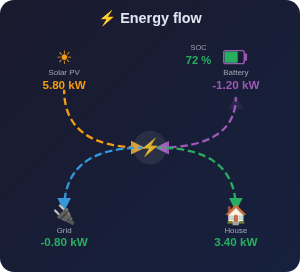
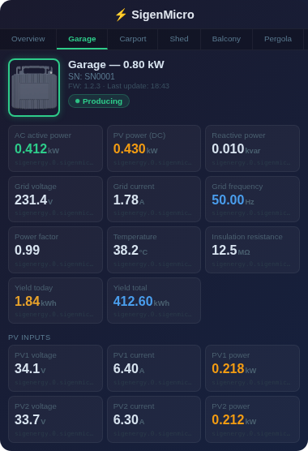

# ioBroker.vis-2-widgets-sigenergy

**Tests:** 

## ioBroker 的 vis-2-widgets-sigenergy 适配器

用于 Sigenergy 储能适配器的 VIS-2 小部件集 (`ioBroker.sigenergy`).
包含 10 个小部件,用于可视化和控制能量流、电池状态、实时功率、每日统计、AC 充电器、DC 充电器、逆变器、SigenMicro 微型逆变器概览、光伏组串和车辆电量。

自 2.0.0 版本起,这些小部件是原生的 vis-2 React 小部件集(React 19、MUI 9)。

## 要求

- 已安装并配置 `sigenergy` 适配器的 ioBroker
- ioBroker VIS-2 适配器(≥ 2.20.0)— vis-2 2.20 是首个基于 React 19 和 MUI 9 的版本
- 不支持经典 VIS(vis-1)

## 从 1.x 升级

- 现有小部件无需重新放置即可继续使用:小部件 ID 和所有设置(对象 ID、标题、深色模式、名称)均与之前相同。
- 必须先将 vis-2 更新到 2.20.0 或更高版本。较旧的 vis-2 版本基于 React 18,无法加载此小部件集。
- 所有文本均跟随 vis-2 的语言(11 种语言)。您自行输入的标题会被保留;标题为空时显示用户语言的默认标题。
- 状态说明(AC/DC 充电器)以工具提示的形式显示,不再被小部件截断,并且在任何小部件尺寸下都清晰可读。

## 小部件

### 能量流图
Displays the current energy flow between solar panels, battery, grid and house as an animated SVG diagram.
Animated arrows visualise active connections in real time.

**OIDs:** `pvPower`, `essPower`, `gridActivePower`, `housePower`, `essSoc`

#### Flow directions

| Data point | Value > 0 | Value < 0 |
|---|---|---|
| `essPower` | Battery charging → arrow from centre to battery | Battery discharging → arrow from battery to centre |
| `gridActivePower` | Grid consumption → arrow from grid to centre | Grid feed-in → arrow from centre to grid |
| `pvPower` | PV producing → arrow from PV to centre | — |
| `housePower` | House consuming → arrow from centre to house | — |

### 电池状态与预测
Displays SOC, SOH, charging power and forecasts for time to full charge, remaining runtime, self-consumption and autarky rate.

**OIDs:** `essSoc`, `essSoh`, `essPower`, `batteryTimeToFull`, `batteryTimeRemaining`, `selfConsumptionRate`, `autarkyRate`

### 实时功率
Compact list view of all current power values with colour-coded direction indicators.

**OIDs:** `pvPower`, `essPower`, `gridActivePower`, `housePower`, `essSoc`

### 能量统计
Daily overview with autarky rate, self-consumption, SOC history, charge/discharge energy and battery coverage.

**OIDs:** `autarkyRate`, `selfConsumptionRate`, `dayMaxSoc`, `dayMinSoc`, `essDailyChargeEnergy`, `essDailyDischargeEnergy`, `batteryCoverageToday`, `batteryDailyChargeTime`

### AC Charger (Sigen EVAC)
Monitoring and control of the Sigenergy AC charger (EVAC). Shows charging power, system state, rated power, rated current and total energy consumed. Alarms are highlighted in colour. The state badge shows the simplified charging state according to IEC 61851-1 (Initialising, Free, Connected, Charging, Error); hovering over it reveals a detailed explanation of the current state. The charging current can be set directly via a slider (6 A up to the charger's rated current); the upper limit can additionally be capped with the widget setting `sig_maxCurrent`. While charging is active, the Start button is locked and the Stop button is highlighted.

**OIDs:** `acCharger.systemState`, `acCharger.chargingPower`, `acCharger.totalEnergyConsumed`, `acCharger.ratedPower`, `acCharger.ratedCurrent`, `acCharger.alarm1/2/3`, `acCharger.control.startStop`, `acCharger.control.outputCurrent`

### DC 充电器
Monitoring and control of the Sigenergy DC charger. Shows output power, vehicle SOC with progress bar, vehicle battery voltage, charging current and the energy and duration of the current charging session. The state badge shows the operating state of the charging station (`dcCharger.runningState`: free, connected/preparing, scheduled, charging, discharging, ended, warning, fault/unavailable); hovering over it reveals a detailed explanation. While charging or discharging is active, the Start button is locked and the Stop button is highlighted. If the state OID is not set, it is derived from the output power OID; without a state value the badge falls back to the output power and the tooltip explains why, depending on the protocol version detected by the adapter.

**OIDs:** `dcCharger.runningState`, `dcCharger.outputPower`, `dcCharger.vehicleSoc`, `dcCharger.vehicleBatteryVoltage`, `dcCharger.chargingCurrent`, `dcCharger.currentChargingCapacity`, `dcCharger.currentChargingDuration`, `dcCharger.control.startStop`, `info.protocolVersion` (`oid_protocol`)

### 逆变器
Comprehensive monitoring and control of the inverter with tab navigation. Displays operating state, power data, battery temperatures, phase voltages, all 5 alarm registers and device information (model, serial number, firmware).

| Tab | Content |
|---|---|
| **Power** | Active power, PV power, battery charge/discharge power, power share slider (−100 % to +100 %) |
| **Battery** | SOC & SOH with bars, avg. cell temperature/voltage, max./min. temperature |
| **Grid** | Phase voltages L1/L2/L3, grid frequency, power factor, PCS internal temperature |
| **Alarms** | 5 alarm registers (PCS ×2, ESS, gateway, DC charger) with hex code and colour marking |
| **Info** | Model type, serial number, firmware version, Remote-EMS toggle |

**OIDs:** `inverter.activePower`, `inverter.pvPower`, `inverter.essChargeDischargePower`, `inverter.runningState`, `inverter.essBatterySoc/Soh`, `inverter.essAvgCellTemperature/Voltage`, `inverter.phaseA/B/CVoltage`, `inverter.gridFrequency`, `inverter.pcsInternalTemp`, `inverter.alarm1–5`, `inverter.firmwareVersion`, `inverter.modelType`, `inverter.serialNumber`, `inverter.control.startStop`, `inverter.control.remoteEmsDispatchEnable`, `inverter.control.activePowerPercent`

### PV Power
Display of up to 3 PV strings with live power values and animated flow arrows leading to the hybrid inverter. Arrow colours change dynamically based on power level (orange <1 kW, yellow <2 kW, green >2 kW).

#### Widget settings
| Parameter | Type | Default | Description |
|---|---|---|---|
| oid_pv1 … oid_pv3 | OID | sigenergy.0.plant.pv1Power … pv3Power | PV string power OIDs |
| oid_pvtotal | OID | sigenergy.0.plant.pvPower | Total PV power OID |
| sig_title | text | PV Power | Widget title |
| sig_name1 … sig_name3 | text | String 1 … String 3 | Configurable names per string |
| sig_darkmode | checkbox | true | Dark / Light mode |

**OIDs:** `plant.pv1Power`, `plant.pv2Power`, `plant.pv3Power`, `plant.pvPower`

### SigenMicro 概览
SigenMicro 微型逆变器的概览和详细视图。自 `ioBroker.sigenergy` 3.5.0 起，适配器通过 Sigenergy 云端读取微型逆变器（适配器设置中的“SigenMicro (Cloud)”选项卡），并为每台微型逆变器在 `sigenergy.0.sigenmicro.<序列号>` 下创建一个设备。**需要启用云端的 `ioBroker.sigenergy` ≥ 3.5.0。** 云端每 300 秒（OpenAPI）或 60 秒（应用接口）轮询一次，因此小部件无法更快地更新。

| 选项卡 | 内容 |
|---|---|
| **Overview** | 所有设备显示为带动画的交流母线，并显示每台设备的状态；磁贴显示交流功率（适配器总和 `sigenmicro.totalPower`，否则为各设备之和）、今日发电量、累计发电量和在线设备数 |
| **每台设备一个选项卡** | 图片、名称、额定功率、序列号、固件、最近一次云端更新时间、状态徽章、所有实时值（含单位和 OID），以及适配器上报的光伏输入 pv1 … pv4 |

#### 状态
| 状态 | 条件 | 显示 |
|---|---|---|
| Producing | `online` = true, `activePower` > 0 | 绿色，母线动画 |
| Online | `online` = true, `activePower` = 0 | 蓝色 |
| Offline | `online` = false — 夜间属正常 | 灰色 |
| No data | 尚未收到数值 | 灰色 |

如果 `info.cloudConnection` 为 `false`，小部件会显示警告“Cloud connection lost”，因为数值可能已过时。

#### 动态布局
| 设备数 | 行数 | 图片尺寸 |
|---|---|---|
| 1–5 | 1 行 | 80 × 90 px |
| 6–10 | 1 行 | 52 × 60 px |
| 11–15 | 2 行 | 46 × 52 px |
| 16–20 | 2 行 | 40 × 46 px |

#### 小部件设置
| 参数 | 类型 | 默认值 | 说明 |
|---|---|---|---|
| micro_count | 数字 (1–20) | 3 | 要显示的微型逆变器数量 |
| sig_title | 文本 | SigenMicro Micro-Inverter | 小部件标题 |
| sig_darkmode | checkbox | true | 深色 / 浅色模式 |
| micro_device1 … micro_device20 | 选择 | — | 从 sigenergy 实例的 SigenMicro 设备列表中选择微型逆变器（序列号和名称）。小部件会自行读取该设备的所有状态。1.x 版本的小部件保留原来的状态选择 |
| micro_take_all | 按钮 | — | 一次性导入账户中的所有 SigenMicro 设备（数量和选择） |
| micro_name1 … micro_name20 | 文本 | — | 设备显示名称（默认：Micro 01、Micro 02 …） |

**每台设备的状态 (`sigenergy.0.sigenmicro.<serial>`):**
online, activePower, reactivePower, pvPower, pv1…pv4.voltage / current / power, gridVoltage, gridCurrent, gridFrequency, powerFactor, temperature, insulationResistance, dailyYield, totalYield, serialNumber, firmware, ratedPower, lastUpdate

**此外:** `sigenergy.0.sigenmicro.totalPower`, `sigenergy.0.info.cloudConnection` — 实例取自所选 OID

> **从 1.8.x 升级:** 适配器中已不再有以前的 Modbus 状态（`runningState`、`outputPower`、`mppt*`、`modelType` …）。请在小部件设置中重新选择微型逆变器 — 从列表中选择或使用“导入全部 SigenMicro”。

### 车辆电量显示 (EV SOC)
将可配置的车辆图片（如 Fiat 500e）作为中心视觉元素显示。右上角的彩色徽章显示闪电符号、当前电量百分比和标签"电量"(已翻译)。底部的进度条反映当前 SOC。当可选充电状态激活时，徽章会发出绿色脉冲光晕。

#### 颜色逻辑
| 电量 | 颜色 |
|---|---|
| ≤ 15 % | 红色 (#f87171) |
| ≤ 35 % | 黄色 (#fbbf24) |
| > 35 % | 绿色 (#4ade80) |

#### 控件设置
| 参数 | 类型 | 默认值 | 说明 |
|---|---|---|---|
| oid_ev_soc | OID | — | 电量 0–100 |
| oid_charging | OID | — | 充电状态（可选）— 充电时绿色光晕 |
| sig_title | 文本 | —(为空时显示"车辆电量",已翻译) | 图片下方显示的车辆名称 |
| sig_car_image | 图片 | — | 来自 ioBroker 文件浏览器的车辆图片（如 /vis-2/img/） |
| sig_darkmode | 复选框 | true | 深色 / 浅色模式 |

**OIDs:** `oid_ev_soc`, `oid_charging`

## 外观

所有小部件均支持**浅色和深色模式**,可通过小部件设置 `Dark mode` 切换。小部件会随其尺寸缩放:宽度和高度分别独立跟随小部件,而文字保持其比例。

## 更新日志
### 2.0.1 (2026-11-17)
* (ssbingo) 更新了 README 截图：所有小部件均按 vis-2 2.20 中 React 小部件集的显示效果呈现，使用英文文本
* (ssbingo) 更新了依赖项（vite 7.3.8, `@iobroker/gui-components` 10.4.6, `@iobroker/testing` 6.3.2）

### 2.0.0 (2026-11-17)
* (ssbingo) **Breaking:** 小部件现在是原生的 vis-2 React 小部件集(React 19、MUI 9),需要 vis-2 2.20.0 或更高版本。不再支持经典 VIS(vis-1)
* (ssbingo) 现有小部件无需重新放置即可继续使用:小部件 ID 和所有设置均未改变
* (ssbingo) 所有文本均已翻译为 ioBroker 的 11 种语言(之前大多为德语)。已输入的标题会被保留;标题为空时显示用户语言的默认标题
* (ssbingo) AC/DC 充电器:状态说明改为 MUI 工具提示,不再被小部件截断;充电电流和 EMS 功率份额改为 MUI 滑块,松开时写入
* (ssbingo) vis-2 编辑器中不再发送任何命令;在编辑器中单击只会选中小部件
* (ssbingo) 能量流:设置"动画流"现已生效
* (ssbingo) SigenMicro:详情选项卡以三列显示数值,对象 ID 显示在一行中
* (ssbingo) SigenMicro：在编辑器中按设备（序列号和名称）从 sigenergy 实例的 SigenMicro 设备中选择微型逆变器；小部件会自行读取所有状态。新增按钮“导入全部 SigenMicro”可一次导入所有设备。1.x 版本的小部件继续使用原来的状态选择
* (ssbingo) 使用 Vite 和模块联邦构建;小部件已在 vis-2 2.20.11 中测试

### 1.9.1 (2026-11-17)
* (ssbingo) vis-2 2.20.x：小部件重新为自身内容设置 `box-sizing: border-box`。vis-2 2.20 不再加载 MUI 的 `CssBaseline`，它以前会把整个文档切换为 border-box，因此带内边距的卡片、磁贴和按钮可能比设计的更宽。该规则仅作用于本小部件集；本小部件集不含 React/MUI 代码，作为经典 vis 小部件集在 vis-2 2.20（React 19、MUI 9）下运行

### 1.9.0 (2026-11-17)
* (ssbingo) **SigenMicro 概览已针对 `ioBroker.sigenergy` 3.5.0 的新云端接入进行重构。** 小部件现在读取 `sigenergy.0.sigenmicro.<序列号>.*`（online、activePower、pvPower、光伏输入 pv1…pv4、电网数值、温度、绝缘电阻、发电量、固件、额定功率、最近更新时间）、账户总功率 `sigenmicro.totalPower` 以及 `info.cloudConnection`。原有的 Modbus 寄存器模型（`runningState`、`outputPower`、`mppt*`、`modelType`）已移除
* (ssbingo) SigenMicro：状态由 `online` 和交流功率得出（Producing / Online / Offline / No data），云端连接中断时显示警告，详情选项卡显示最近一次云端更新时间和额定功率，光伏输入仅在有上报时显示，每台设备新增可选显示名称（`micro_nameN`），所有小部件文本改为英文
* (ssbingo) SigenMicro：锚点 OID 可以是微型逆变器的任意状态；派生状态现在通过 `vis.conn.subscribe` 订阅（VIS 只订阅属性中的 OID），并在移除小部件时释放。**更新后，请为每个 `oid_microN` 重新选择 `sigenergy.0.sigenmicro.<序列号>` 下的一个状态**
* (ssbingo) CI：按 ioBroker 模板更新 Dependabot 自动合并工作流 — 改用 `pull_request` 代替 `pull_request_target`（#46、#47）；`@iobroker/testing` 从 6.2.1 更新到 6.3.1

### 1.8.11 (2026-09-12)
* (ssbingo) CI：软件包测试现在在 Node.js 22、24 和 26 上运行（新增 `adapter-tests` 作业，仓库检查器 #41）；`@iobroker/testing` 从 5.3.0 更新到 6.2.1

### 1.8.10 (2026-09-07)
* (ssbingo) 从 `globalDependencies` 中移除了 `admin` 条目：微件集没有管理界面，因此无需要求任何 admin 版本（仓库检查器 S1091）

### 1.8.9 (2026-09-07)
* (ssbingo) DC 充电桩：充电桩将运行状态寄存器标记为无效时，不再显示红色的“Unbekannt”标记。Sigenergy 协议通过将所有位置一来表示“寄存器无效”，带有 DC 充电桩的 SigenStor EC 对寄存器 31513 就是这样应答的，而相邻寄存器（额定功率、PV 发电量、计量值）读取正常。此时状态标记根据输出功率推导，提示信息说明这既不是适配器问题也不是配置问题
* (ssbingo) DC 充电桩：原始哨兵值 65535 同样会被识别，因此在 3.3.1 之前的适配器版本（直接透传该值而不是报告无值）上状态标记也正确
* (ssbingo) DC 充电桩：新增 OID 设置 `oid_protocol`（默认 `sigenergy.0.info.protocolVersion`）。此前协议版本仅从实例前缀推导，VIS 不会订阅这样的 OID，`vis.states` 保持为空，提示信息错误地声称“尚未检测到协议版本”，尽管适配器在启动时已检测到 V2.9。作为常规 `/id` 属性声明后，它像其他 OID 一样被订阅
* (ssbingo) DC 充电桩：无法读取协议版本时，提示信息不再声称未检测到版本，而是说明此处无法读取并指向新的设置
* (ssbingo) DC 充电桩：重新措辞了设备声明协议 V2.8 或更高但适配器未报告状态时显示的提示信息；不再声称需要更新适配器，因为充电桩本身可能将该寄存器标记为无效

### 1.8.8 (2026-09-07)
* (ssbingo) DC 充电桩：未设置状态 OID 时，将从输出功率 OID 推导（…dcCharger.outputPower → …dcCharger.runningState），因此在 1.8.7 之前放置的微件无需编辑即可显示运行状态
* (ssbingo) DC 充电桩：无运行状态可用时，提示信息会根据适配器检测到的协议版本（`info.protocolVersion` / `info.protocolLevel`）说明原因：寄存器 31513 需要 Sigenergy 协议 V2.8；V2.8 及以上时提示查看适配器日志或更新适配器；负的输出功率显示为放电

### 1.8.7 (2026-09-07)
* (ssbingo) DC 充电桩：新增状态 OID `dcCharger.runningState`（默认）——状态标记现在显示充电桩的运行状态（空闲、已连接/准备中、已计划、充电中、放电中、已结束、警告、故障/不可用），并以提示信息显示详细说明；未配置该 OID 时，状态标记仍像以前一样根据输出功率推断
* (ssbingo) DC 充电桩：充电或放电进行中时，Start 按钮被锁定，Stop 按钮高亮显示；负的输出功率（放电）以紫色显示

### 1.8.6 (2026-09-07)
* (ssbingo) AC 充电桩：状态标记的提示信息现在以独立弹出层显示，字体大小固定、背景不透明，因此无论微件大小都清晰可读，且不再被微件内容遮挡
* (ssbingo) AC 充电桩：充电进行中时，Start 按钮被锁定，Stop 按钮高亮显示
* (ssbingo) 微件集现在在浏览器控制台中报告正确的版本

### 1.8.5 (2026-09-07)
* (ssbingo) AC 充电桩：充电电流滑块现在限制为充电桩的额定电流；新增微件设置 `sig_maxCurrent` 用于手动设置上限（避免设置超过额定电流时出现 Modbus 错误）
* (ssbingo) AC 充电桩：系统状态现已覆盖所有 IEC 61851-1 状态（0–7：初始化、空闲、已连接、充电中、故障）；将鼠标悬停在状态标记上会显示详细说明

### 1.8.4 (2026-09-04)
* (ssbingo) 最低 admin 要求降至 >=7.8.23（不再需要 admin 8）
* (ssbingo) CI：ioBroker/testing-action-deploy 锁定为主版本 v1；修复 Dependabot 自动合并工作流
* (ssbingo) 更新依赖：@tsconfig/node22 22.0.6、@alcalzone/release-script-plugin-license 5.2.2

### 1.8.3 (2026-08-05)
* (ssbingo) 已声明最低要求：js-controller >=6.0.11、admin >=8.0.0、Node.js >=22
* (ssbingo) 更新依赖：actions/checkout 7.0.1、ioBroker/testing-action-deploy 1.5.2、@iobroker/testing 5.3.0

### 1.8.2 (2026-06-28)
* (ssbingo) 更新 CI actions：actions/checkout 至 v7.0.0，ioBroker/testing-action-deploy 至 v1.5.0

### 1.8.1 (2026-06-08)
* (ssbingo) 修复 io-package.json 中的 JSON 语法错误；文档中添加了控件截图

### 1.8.0 (2026-06-08)
* (ssbingo) 新控件：「车辆电量显示」——显示可配置的电动汽车图片，带动画 SOC 进度条、颜色编码电量（红/黄/绿）和可选闪烁充电徽章

### 1.7.9 (2026-05-27)
* (ssbingo) 删除了过时的 .eslintrc.json 和 .prettierignore

### 1.7.8 (2026-05-27)
* (ssbingo) 添加了 ESLint 代码检查，CI 更新至 Node.js 24；适配器需要 node.js >= 22

### 1.7.7 (2026-04-20)
* (ssbingo) 文本在非等比缩放时不再变形 — 字母保持原有比例,同时容器继续填满小部件区域

### 1.7.6 (2026-04-20)
* (ssbingo) 缩放现在是非等比的:宽度和高度独立响应容器变化,两个轴可分别调节

### 1.7.5 (2026-04-20)
* (ssbingo) 小部件缩放现在也会响应高度变化 — 内容在两个轴上按比例缩放并在小部件中居中

### 1.7.4 (2026-04-20)
* (ssbingo) 所有 9 个小部件现在会随着小部件大小响应式地缩放其内容(字体、间距、SVG、图像)

### 1.7.3 (2026-04-20)
* (ssbingo) 所有 9 个小部件现在共享基于 PV-Power 小部件设计的统一背景

## Documentation

- 🇬🇧 [English](README.md) — this file
- 🇩🇪 [Deutsch](doc/de/README.md)
- 🇷🇺 [Русский](doc/ru/README.md)
- 🇳🇱 [Nederlands](doc/nl/README.md)
- 🇫🇷 [Français](doc/fr/README.md)
- 🇮🇹 [Italiano](doc/it/README.md)
- 🇪🇸 [Español](doc/es/README.md)
- 🇵🇱 [Polski](doc/pl/README.md)
- 🇵🇹 [Português](doc/pt/README.md)

## License
MIT License

Copyright (c) 2026 ssbingo <s.sternitzke@online.de>

Permission is hereby granted, free of charge, to any person obtaining a copy
of this software and associated documentation files (the "Software"), to deal
in the Software without restriction, including without limitation the rights
to use, copy, modify, merge, publish, distribute, sublicense, and/or sell
copies of the Software, and to permit persons to whom the Software is
furnished to do so, subject to the following conditions:

The above copyright notice and this permission notice shall be included in all
copies or substantial portions of the Software.

THE SOFTWARE IS PROVIDED "AS IS", WITHOUT WARRANTY OF ANY KIND, EXPRESS OR
IMPLIED, INCLUDING BUT NOT LIMITED TO THE WARRANTIES OF MERCHANTABILITY,
FITNESS FOR A PARTICULAR PURPOSE AND NONINFRINGEMENT. IN NO EVENT SHALL THE
AUTHORS OR COPYRIGHT HOLDERS BE LIABLE FOR ANY CLAIM, DAMAGES OR OTHER
LIABILITY, WHETHER IN AN ACTION OF CONTRACT, TORT OR OTHERWISE, ARISING FROM,
OUT OF OR IN CONNECTION WITH THE SOFTWARE OR THE USE OR OTHER DEALINGS IN THE
SOFTWARE.
